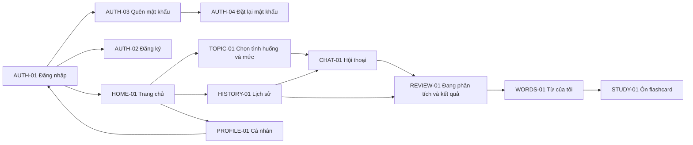

# 02 — Màn hình, luồng người dùng và nghiệp vụ

## 1. Bản đồ màn hình



## 2. Quy định từng màn hình P0

| ID | Dữ liệu/API | Thao tác chính | Loading/rỗng/lỗi phải có |
| --- | --- | --- | --- |
| AUTH-01 | loginWithPassword/loginWithGoogle/refreshSession/getCurrentUser | Email/mật khẩu hoặc nút Google; có link đăng ký/quên mật khẩu | Chặn bấm lặp; Google bị hủy quay lại bình thường; lỗi mạng giữ form; không lưu mật khẩu |
| AUTH-02 | registerAccount | name, email, password, level tùy chọn; thành công trở về login | Báo lỗi validation/409 email; không có role/id/active trong body |
| AUTH-03 | requestPasswordReset | Nhập email, gửi yêu cầu | 202 hiện thông báo chung; không hiển thị email có tồn tại hay không; SMTP chưa sẵn sàng là 503 |
| AUTH-04 | resetPassword | email + mã 6 số + mật khẩu mới | Sai/hết hạn cùng thông báo; thành công về login; không tự đăng nhập |
| HOME-01 | User trong phiên; listConversations/listSavedWords nếu cần số liệu | Vào luyện nói, lịch sử, từ cá nhân, hồ sơ | Không dùng số giả; có thể bỏ các thẻ thống kê chưa nối. `total` lịch sử là số hội thoại, không mặc định là bài đã hoàn tất |
| TOPIC-01 | listTopics | Chọn topic.id và A1/A2/B1/B2; tạo createRequestId một lần | Tải/rỗng/thử lại; chủ đề vừa tắt thì 409 và tải lại; không truyền tên thay ID |
| CHAT-01 | createConversation/sendConversationMessage/getConversation | Mic, bản nháp text, gửi, dừng/nghe lại AI, Kết thúc | Tin đang gửi khác tin đã lưu; tối đa một lượt chưa xong; có retry cùng requestId; không có góp ý giữa phiên |
| REVIEW-01 | finishConversation/getConversationReview/retryConversationReview | Xem trạng thái, góp ý, câu gốc/câu sửa, chọn từ lưu | PROCESSING, FAILED, INSUFFICIENT_DATA và COMPLETED hiển thị riêng; dữ liệu rỗng không bị bịa |
| HISTORY-01 | listConversations/getConversation | Bài mở → tiếp tục; bài đóng → xem transcript/kết quả | Phân trang; trạng thái rõ; mở lịch sử không tự phát tất cả câu AI |
| WORDS-01 | listSavedWords/saveSuggestedWords | Một danh sách, lọc NEW/LEARNING/MASTERED, mở ôn | Không tạo bộ thẻ; rỗng hướng dẫn luyện một bài rồi lưu từ |
| STUDY-01 | reviewSavedWord | Hiện word → lật meaning/example; Chưa nhớ/Đã nhớ | Chỉ ghi trạng thái khi người dùng bấm đánh giá; xoay màn hình/lật thẻ không tự cập nhật |
| PROFILE-01 | getCurrentUser/linkGoogleAccount/logoutAccount | Hồ sơ an toàn, Google đã liên kết hay chưa, logout | Phiên bị thu hồi về login; lỗi mạng không thông báo logout server thành công khi chưa thành công |

AUTH-01/PROFILE-01 đã có một phần code; các dòng còn lại là hành vi cần hoàn thiện. Gán API theo operationId trong OpenAPI, không suy ra URL từ tên màn hình.

## 3. Nói và nghe theo lượt

Trạng thái FE: `IDLE → LISTENING → DRAFT hoặc SENDING → WAITING_AI → SPEAKING → IDLE`. Nhánh Kết thúc: `CLOSING → REVIEW_PROCESSING → REVIEW_TERMINAL`. Đây là trạng thái giao diện, không phải enum mới phải thêm vào MySQL.

- Mic chỉ xin RECORD_AUDIO lúc sử dụng; bị từ chối vẫn có text input. Kiểm tra thiết bị có dịch vụ nhận dạng/TTS và giọng tiếng Anh.
- Chỉ dùng kết quả nhận dạng **cuối cùng**, mặc định tự gửi một lần. Nếu người dùng bật “Xác nhận trước khi gửi”, đưa vào bản nháp để sửa rồi gửi.
- Không bật mic khi TTS phát. Nút dừng giọng đưa về trạng thái có thể nói; không tạo tin khác.
- TTS chỉ đọc lời AI của lượt vừa hoàn thành, không đọc nhận xét hoặc toàn bộ lịch sử. TTS lỗi không gọi AI lại.
- Khi app xuống nền/rời màn hình: dừng mic/TTS; trở lại GET conversation. Không tự bật mic.
- Bấm Kết thúc có bản nháp: hỏi “Gửi trước khi kết thúc” hoặc “Bỏ bản nháp và kết thúc”. Đang gửi một lượt thì có thể kết thúc; dừng phát và bỏ qua response muộn theo trạng thái hiện tại.
- Bản nháp/gửi đang chờ cần lưu tạm theo **userId + conversationId**; logout xóa dữ liệu tạm của phiên. Giữ nguyên UUID/content trước khi gọi mạng; mất response không sinh UUID khác.

```mermaid
sequenceDiagram
    participant FE as Android
    participant BE as Backend
    participant DB as MySQL
    participant AI as AI provider
    FE->>BE: POST messages(content, requestId)
    BE->>DB: Khóa ngắn, lưu USER và processingToken
    BE->>AI: Tình huống + mức + transcript
    AI-->>BE: Một lời đáp
    BE->>DB: So token, chưa đóng thì lưu AI
    BE-->>FE: 200 cặp tin
    FE->>FE: Hiện text rồi đọc TTS
    FE->>BE: POST finish
    BE->>DB: Ghi endedAt một lần; thay token lời đáp bằng token review
    BE->>AI: Đánh giá sau bài
    BE->>DB: Kiểm tra và lưu toàn bộ báo cáo
    BE-->>FE: 200 kết quả hoặc lỗi có thể khôi phục
```

## 4. Chat và báo cáo

Người học mở lượt đầu tiên. **Bỏ lời chào tự sinh trong ChatFragment hiện tại** khi chuyển qua API thật; không hiển thị một câu AI không có trong server. Chat header dùng topicName, level và bối cảnh đã nhận.

Trong chat chỉ có content USER/AI. Sai ngữ pháp cũng tiếp tục trò chuyện; người học yêu cầu sửa ngay thì AI giữ cách trò chuyện và để phần sửa đến cuối. Không gửi JSON báo cáo qua endpoint lời đáp.

COMPLETED hiển thị summary, strengths, weaknesses, recommendedLevel/levelFeedback, grammarCorrections và suggestedWords. Câu gốc/câu sửa là tiếng Anh, nhận xét bằng tiếng Việt. grammarCorrections có thể rỗng. Mỗi lỗi bấm được để tìm đúng tin USER qua messageId.

Đủ dữ liệu ban đầu: ít nhất **3 tin USER và 30 từ tiếng Anh**; BE đếm từ bằng mẫu `[A-Za-z]+(?:'[A-Za-z]+)?` trên các câu USER, không đếm lời AI. Đây là ngưỡng kỹ thuật, không phải chuẩn CEFR. AI vẫn có quyền trả INSUFFICIENT_DATA khi nội dung không đủ ý nghĩa. Khi thiếu dữ liệu: giữ lịch sử, hiển thị summary giải thích; không có recommendedLevel/câu sửa/từ gợi ý.

Trình độ gồm ba giá trị độc lập: mức hồ sơ snapshot, mức chọn cho bài, mức được khuyên. Không tự sửa users.level sau báo cáo; chưa có điểm phát âm hoặc điểm CEFR chính thức.

## 5. Lưu từ và ôn

Chỉ gợi ý thuộc báo cáo COMPLETED được chọn lưu. FE gửi suggestionIds; không gửi word/meaning/userId để tự tạo kết quả. Response tách created và existing. Từ đã có giữ nguyên nghĩa cá nhân, FE hiện “Đã có trong Từ của tôi”. Không chọn từ vẫn hoàn thành bài.

saved_words.status mặc định NEW. Ở STUDY-01: Chưa nhớ → LEARNING; Đã nhớ → MASTERED; lastReviewedAt do BE đặt. Đây là **tự đánh giá lần ôn gần nhất**, không phải thuật toán spaced repetition. Nội dung cùng một từ có thể xuất hiện ở nhiều bài, nhưng một người chỉ có một saved_word theo ràng buộc DB.

## 6. Admin P0

| ID | Màn hình | Quy tắc |
| --- | --- | --- |
| ADMIN-01 | Login email/mật khẩu dùng API auth chung | Chỉ ADMIN vào trang thao tác; USER gọi API admin vẫn bị BE trả 403 |
| ADMIN-02 | Danh sách chủ đề gồm cả đang bật/tắt | Tìm theo tên trên danh sách; có phân trang nếu cần; không dùng listTopics learner để mất chủ đề tắt |
| ADMIN-03 | Form thêm/sửa | name, description, level, scenario; tên trùng 409, field sai 400 |
| ADMIN-04 | Bật/tắt | PATCH active; không xóa cứng; bài đang mở giữ snapshot và vẫn tiếp tục được |

FE làm trang HTML/CSS/JavaScript nhỏ trong static/admin của backend, dùng fetch. BE mở tài nguyên `/admin/**` để trang tải được, vẫn khóa `/api/v1/admin/**` bằng ADMIN. Chín endpoint auth và tất cả API được giữ JWT; không thêm cơ chế đăng nhập thứ hai. Phiên admin ở bộ nhớ trang, reload thì login lại để tránh thêm bài toán lưu token web trong ba ngày.
