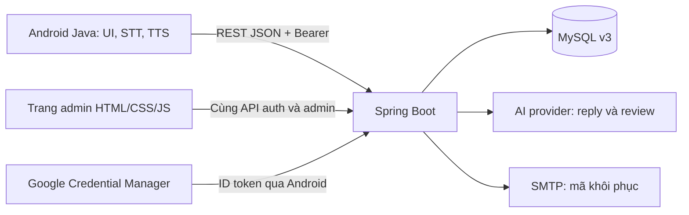
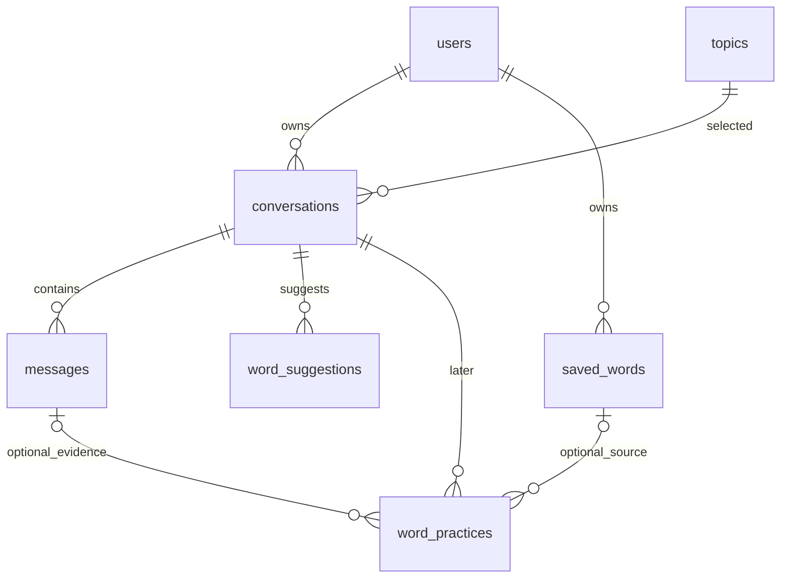
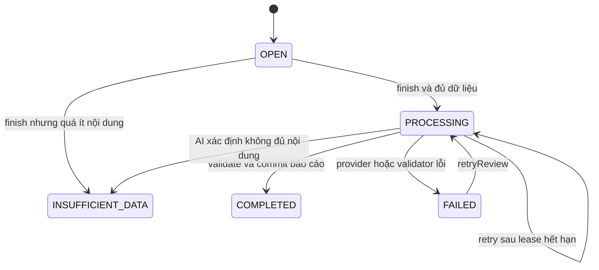

# 04 — Kiến trúc, dữ liệu và bản đồ code

## 1. Một hệ thống đủ nhỏ để người viết giải thích được

Không đưa khóa AI, SMTP password, JWT signing secret vào FE. Google Web client ID là định danh công khai, phải giống audience BE kiểm. Ba ngày chỉ dùng một Spring Boot và một MySQL. Trang admin cùng origin với API để không thêm bài toán triển khai một web project khác.

Luồng code chính giữ phong cách quen thuộc: **Controller → Service → TransactionService/Repository → Entity; Mapper → response DTO**. Service là class cụ thể, constructor injection; Mapper viết tay; không tạo BaseCrudService hoặc ServiceImpl cho từng bảng. Chỉ interface hóa ranh giới cần thay khi test: AiClient, GoogleIdentityVerifier, PasswordResetMailer.

## 2. Dữ liệu và quan hệ

| Bảng | Dùng trong ba ngày | Điểm phải hiểu |
| --- | --- | --- |
| users | Có | USER/ADMIN, local/Google, một phiên và một mã reset hiện hành |
| topics | Có | Admin quản lý, tắt thay vì xóa; level là gợi ý |
| conversations | Có | Chủ sở hữu, UUID tạo bài, snapshot, endedAt và một báo cáo hiện hành |
| messages | Có | Câu gốc USER/AI; hai câu cùng lượt dùng requestId chung |
| word_suggestions | Có | Các từ thuộc báo cáo bài, không phụ thuộc việc có được lưu hay không |
| saved_words | Có | Từ cá nhân và trạng thái lần ôn gần nhất; không có deck_id |
| word_practices | Chưa dùng | Giữ hướng luyện lại; không tạo API chỉ để dùng đủ bảy bảng |

Chi tiết kiểu/khóa/CHECK/3NF xem [từ điển SQL](../SpeakMate-thiet-ke-co-so-du-lieu.md). Contract không đổi SQL v3. Ràng buộc DB không kiểm được toàn bộ quyền sở hữu, nội dung AI hoặc thứ tự đóng phiên; Service phải làm.

## 3. Ba loại ID không được nhầm

| Tên | Ai tạo? | Phạm vi | Khi retry? |
| --- | --- | --- | --- |
| createRequestId | FE, UUID v4 | Một thao tác bắt đầu bài; UNIQUE(user_id, create_request_id) | Giữ nguyên và cùng topicId/level |
| requestId | FE, UUID v4 | Một câu USER + lời đáp AI; UNIQUE(conversation_id,request_id,sender) | Giữ nguyên và cùng content đã chuẩn hóa |
| processingToken | BE, UUID | Một attempt gọi provider; chỉ trong server/DB | Đổi mỗi attempt, không trả FE |

`conversation.id` và `message.id` là Long do DB cấp. Google subject là danh tính Google, không phải processingToken. Access/refresh token là phiên đăng nhập, không phải requestId.

## 4. Trạng thái và transaction

OPEN là `ended_at=NULL/review_status=NOT_STARTED`. Bốn trạng thái còn lại là bài đã đóng. Trong khi OPEN vẫn có thể có processingToken của một lời đáp; đó không phải báo cáo. Mỗi conversation chỉ có một attempt hợp lệ tại một thời điểm.

### 4.1 Tạo bài

Transaction ngắn: lấy user đang hoạt động → tìm createRequestId theo user → có thì so topicId/level và trả bài cũ → chưa có mới kiểm topic đang bật → chép level hồ sơ/tên/scenario → INSERT. Không gọi AI khi tạo, transcript ban đầu rỗng.

Bản hiện tại khóa user trước khi tìm UUID, nên hai yêu cầu tạo bài của cùng user được xếp lần lượt, không đua qua bước kiểm trùng. UNIQUE vẫn bảo vệ thêm ở DB. Không bắt lỗi và tiếp tục query trong transaction đã bị đánh dấu rollback.

### 4.2 Gửi lời nói

1. **Transaction nhận lượt:** xác minh lại tài khoản/phiên, khóa conversation theo chủ sở hữu. Tìm UUID cũ trước; so content, trả kết quả nếu có. Với lượt mới: bài phải mở, không có USER chưa được xử lý, chưa đủ 20 USER; lưu USER và processingToken/time cùng lúc rồi commit.
2. **Ngoài transaction:** lấy transcript đã lưu, build prompt, gọi AiClient.generateReply tối đa 20 giây. Không giữ khóa DB khi chờ mạng.
3. **Transaction hoàn tất:** khóa lại, kiểm user còn hợp lệ, bài chưa đóng và token còn đúng; lưu AI với requestId của USER và xóa dấu xử lý. Nếu token/bài không còn phù hợp, bỏ response cũ; không xóa token attempt mới.
4. **Khi lỗi:** chỉ attempt có token còn khớp mới được xóa dấu xử lý của nó. USER vẫn tồn tại; GET tính pendingReply=RETRYABLE. Retry cùng UUID nhận token mới, không tạo USER mới.

Lease 90 giây để phục hồi khi process chết. GET chỉ tính trạng thái PROCESSING/RETRYABLE từ dữ liệu và thời gian, không âm thầm gọi AI hoặc sửa báo cáo. Một lượt mới không được vượt qua USER cũ chưa xong; người học retry hoặc kết thúc.

### 4.3 Kết thúc và đánh giá

Transaction đóng: khóa conversation; nếu đã đóng trả trạng thái hiện có; nếu đang mở thì ghi endedAt đúng một lần. Xóa/vô hiệu token lời đáp, giữ mọi message đã commit. Thiếu ngưỡng dữ liệu thì INSUFFICIENT_DATA ngay; đủ thì đặt PROCESSING và token mới. Commit rồi mới gọi reviewConversation tối đa 45 giây.

Transaction lưu review: chỉ ghi khi conversation đã đóng, PROCESSING và token còn khớp. Kiểm tra toàn bộ báo cáo trước; lưu trường tổng kết, sửa các message USER, tạo word_suggestions rồi chuyển COMPLETED và xóa token trong **một transaction**. Một phần sai thì rollback toàn bộ kết quả. Lỗi được đánh FAILED trong giao dịch riêng còn kiểm token. endedAt/transcript không rollback theo lỗi AI.

Process chết trong lúc PROCESSING: sau 90 giây, GET trả canRetry=true; POST retry mới nhận quyền xử lý. Không cần scheduler/queue AI để bảo đảm phục hồi trong bản này. Server restart không có nghĩa lời gọi AI cũ tiếp tục chạy.

### 4.4 Khi có nhiều loại khóa

Thống nhất thứ tự khi cần khóa: user trước, conversation sau; nhiều conversation hoặc saved_word thì theo ID tăng. Kiểm active và authVersion lại ở giao dịch ghi, vì request có thể đã qua Security rồi người dùng vừa logout/reset. Không cập nhật dữ liệu bằng một JWT cũ chỉ vì nó từng hợp lệ lúc đầu request.

Retry của HTTP không bảo đảm provider chỉ thu phí một lần: nếu provider đã xử lý nhưng response mất, attempt sau có thể gọi lại. Thiết kế bảo đảm **không có hai kết quả DB hợp lệ cho một lượt**; không hứa exactly-once cho dịch vụ bên ngoài.

## 5. Ranh giới AI

| Hàm | Input | Output và kiểm tra |
| --- | --- | --- |
| generateReply | scenario snapshot, level đã chọn, transcript trong giới hạn | Chỉ text lời đáp 1–4000; mục tiêu 1–3 câu tự nhiên; không trường báo cáo |
| reviewConversation | IDs/tin USER và AI, selected level, profile snapshot | Review DTO; validate rồi mới ghi DB |

Đã chọn Gemini, mặc định `gemini-3.5-flash-lite`, adapter `GeminiAiClient` gọi REST; key/model cấu hình ở server theo [file 08](08-doc-code-va-chay-backend.md). Key thật và chất lượng thực tế chưa nghiệm thu. AiClient che giao thức provider, không che nghiệp vụ và không tự gọi Repository.

ReviewValidator kiểm: enum; chuỗi không rỗng/đúng giới hạn; tối đa 20 correction và 10 từ; messageId tồn tại/cùng conversation/sender USER/không trùng; correctedContent/feedback đi cùng; từ/nghĩa không rỗng, không trùng theo quy tắc DB; không nhận danh tính/người sở hữu/trạng thái do AI yêu cầu. originalContent luôn lấy DB. AI báo insufficient thì chỉ giữ summary giải thích.

Prompt và validator định dạng không tự chứng minh AI hội thoại tự nhiên hoặc góp ý đúng. Nhóm phải chạy các ca nội dung ở file 07; không bịa lỗi cho đủ số lượng, không chấm phát âm từ transcript.

## 6. Bản đồ BE — đường dẫn tương đối backend/src/main/java/vn/tailinh/speakmate

| File/nhóm | Trạng thái | Trách nhiệm |
| --- | --- | --- |
| controller/AuthController, PasswordResetController; service auth; security/config | Đã có | Auth, phiên, reset, role/active; tái sử dụng |
| entity/User, Topic, AbstractAuditingEntity; repository tương ứng | Đã có | Mapping và audit; Topic dùng tiếp |
| controller/TopicController, service/TopicService | Đã có | GET chủ đề đang bật |
| controller/AdminTopicController | Đã có | Thêm/sửa nội dung và active, chỉ ADMIN |
| entity/Conversation, Message, WordSuggestion, SavedWord | Đã có | Bốn Entity phục vụ P0, quan hệ/enum theo SQL |
| controller/ConversationController, ReviewController | Đã có | Nhận DTO/create/send/finish/read/retry; không gọi AI trực tiếp |
| service/ConversationService, ReviewService | Đã có | Điều phối cuộc gọi AI giữa các giao dịch |
| service/ConversationTransactionService, ReviewTransactionService | Đã có | Khóa, ownership, claim token, commit USER/AI/end/report |
| service/ai/AiClient, GeminiAiClient | Đã có | HTTP, timeout, map response; không chứa nghiệp vụ DB |
| service/ai/PromptBuilder, ReviewValidator | Đã có | Hai prompt và kiểm báo cáo |
| controller/SavedWordController, service/SavedWordService | Đã có | Lưu nhóm gợi ý, list từ, tự đánh giá ôn |
| repository/*, dto/request/*, dto/response/*, util/mapper/* | Đã bổ sung P0 | Query và DTO cụ thể; không trả Entity |
| util/constant/ReviewStatus, MessageSender, SavedWordStatus | Đã có | Mỗi enum một khái niệm, lưu STRING/VARCHAR |

WordPractice Entity/API chưa cần viết trong P0. Bảng trên đã đối chiếu tên class thực tế ngày 26/10/2026; cách lần theo từng hàm tại [file 08](08-doc-code-va-chay-backend.md).

## 7. Bản đồ FE — com.example.speakmate

> Bảng này mô tả bản tích hợp trước lần pull 29/10/2026. FE hiện tại dùng LoginFragment/RegisterFragment và chưa có các lớp API/session bên dưới. Xem [audit bản hiện tại](13-final-integration-audit.md); không dùng bảng lịch sử này để kết luận APK hiện tại đã nối API.

| File hiện tại | Trách nhiệm đã triển khai |
| --- | --- |
| LoginActivity, AccountActivity, auth/*, ProfileFragment | Google/email/session, register/forgot/reset và API tương ứng |
| api/ApiClient, auth/SessionManager | HTTP/timeout/error code và một khóa refresh dùng chung |
| SpeakingFragment | GET topic, giữ topicId, lưu createRequestId trước network và mở conversation |
| ChatFragment | Nhận conversationId, render messages server, pending/retry, mic/TTS; không có demo reply/lời chào |
| MainActivity.showSpeakingResult | Truyền conversationId, màn hình đọc kết quả server |
| SpeakingResultFragment | Render ReviewResponse theo status, không dùng getVocabulary/nhận xét cố định |
| FlashcardsFragment, SavedWordStudyFragment | SavedWord theo tài khoản, không cần deckId; PATCH lần ôn khi tự đánh giá |
| DemoFlashcardRepository, LocalDeckStore, CreateDeckFragment, DeckDetailFragment | Không làm nguồn dữ liệu/đường điều hướng của bản P0; không cần xóa vội trước khi đã thay luồng |
| HistoryFragment, api/LearningApi, api/PendingRequests | Lịch sử, URL/body API học, UUID/body lưu theo user trước mạng |
| speech/SpeechController | Callback mic/TTS và lifecycle, tách khỏi HTTP; vô hiệu kết quả cũ sau stop |

ApiClient nhận timeout theo operation: auth/GET 15 giây, send 30 giây, finish/retry 60 giây; ApiException có status/code/message. SessionManager khóa đoạn refresh, kiểm token đã được request khác đổi chưa, xoay/lưu cặp mới một lần; không giữ khóa suốt cuộc gọi AI. PendingRequests lưu UUID/body ở no-backup directory, tách theo user. Chi tiết chạy và kiểm chứng tại [file 10](10-tich-hop-android-va-admin.md).

## 8. Admin và tài nguyên static

Đã có HTML/CSS/JS trong `backend/src/main/resources/static/admin/`, mở `/admin/index.html`; form dùng auth và admin topics API chung. Security permit `/admin/**` cho file tĩnh, giữ ADMIN cho `/api/v1/admin/**`. Trang có thể tải công khai nhưng không đọc/ghi dữ liệu khi thiếu quyền. Nội dung nhập bởi admin được render bằng textContent.

Dùng một tài khoản ADMIN riêng cho web, USER riêng cho Android. Quy tắc một phiên/tài khoản vẫn áp dụng; đăng nhập hai thiết bị cùng một tài khoản sẽ thay phiên, không được coi là bug ngẫu nhiên.
