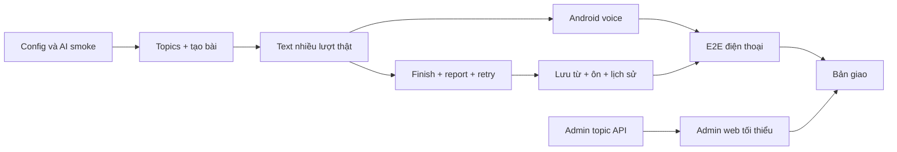

# 06 — Kế hoạch ba ngày cho một FE và một BE

## 1. Cách đọc deadline

T0 là lúc nhóm bắt đầu đợt triển khai, chưa được gán ngày/giờ cụ thể. Hạn giao T0+72 giờ. Mỗi người khoảng **9 giờ ngày 1, 9 giờ ngày 2, 8 giờ ngày 3: tổng 26 giờ/người, 52 giờ công nhóm**. Các block là giờ làm trong ngày, có thể xếp quanh giờ nghỉ; không có yêu cầu code liên tục qua đêm.

Lịch dựa trên nền auth/UI hiện có, vẫn là lịch gấp. Phần mới khó nhất là vòng đời AI và tích hợp voice; 15 endpoint P0 mới không có nghĩa chỉ viết 15 hàm Controller. Không mở thêm P1 để bù cảm giác tiến độ khi đường chính chưa chạy.

## 2. Mốc nghiệm thu bắt buộc

| Mốc | Hạn | Bằng chứng cần thấy |
| --- | --- | --- |
| M0 — đầu vào sẵn sàng | Hai giờ làm đầu tiên | URL server/DB hoạt động; AI thật trả một reply và một review mẫu; điện thoại nhận/phát được tiếng Anh; biết ai xử lý Google/SMTP |
| M1 — đường text thật | Cuối ngày 1, không muộn T0+24h | Android login → GET topic → tạo bài → ít nhất 5 lượt với AI thật, giữ ngữ cảnh; tải lại còn transcript; retry cùng UUID không trùng USER |
| M2 — vòng học thật | Cuối ngày 2, không muộn T0+48h | Nói/nghe hai phía → kết thúc → review/câu sửa/mức luyện → chọn lưu từ → ôn → mở lịch sử; có FAILED/INSUFFICIENT đúng |
| M3 — bản giao | T0+72h | Admin thêm/sửa/tắt chủ đề; P0 và ca dữ liệu/quyền trọng yếu đạt; APK, config guide, SQL, test evidence và demo sẵn |

Mốc có thể hoàn thành sớm nhưng không được tự đánh dấu bằng mock. Lúc ghi kết quả cần nêu “đã thử thật” hoặc “chỉ fixture/test stub”. Các mốc dưới là kế hoạch, chưa đánh dấu đã hoàn tất.

## 3. Ngày 1 — bỏ phụ thuộc demo, nối đường text

| ID | Người | Giờ dự kiến | Công việc | Tiêu chí xong/phụ thuộc |
| --- | --- | --- | --- | --- |
| BE-01 | BE | 1h | Cấu hình DB/JWT; chọn AI/model/key và thử reply/review; chuẩn bị Google/SMTP | M0 có kết quả AI thật, ghi rõ cấu hình còn thiếu; không mua/tạo giá trị bí mật giả |
| BE-02 | BE | 1.5h | listTopics và 4 API admin topics | Gọi CRUD/active được; USER bị 403; topic tắt không tạo bài mới |
| BE-03 | BE | 1.5h | Conversation/Message mapping, create và GET detail | Snapshot/UUID/owner đúng, tạo lại không trùng, transcript ban đầu rỗng |
| BE-04 | BE | 3h | send + AiClient/PromptBuilder + claim/save transaction | USER commit trước AI; cùng UUID trả cùng lượt; provider lỗi giữ USER; không góp ý giữa chat |
| BE-05 | BE | 1h | GET history và pendingReply/lease | FE khôi phục bài/lượt bằng GET; chỉ dữ liệu của mình |
| BE-06 | BE | 1h | Tích hợp trực tiếp với FE và kiểm M1 | 5 lượt thật, không chỉ lệnh gọi rời rạc; ghi lỗi qua requestId |
| FE-01 | FE | 2h | Đọc contract, cấu hình app; hoàn thiện register/forgot/reset form trên auth sẵn có | Form gọi API đúng; Google config rõ; auth errors hiển thị đúng |
| FE-02 | FE | 1h | TopicApi/selector → createConversation | Dùng ID server; level chọn độc lập; lưu createRequestId trước gọi mạng |
| FE-03 | FE | 2h | ChatApi + bind messages/loading/retry | Không còn demo reply/lời chào giả; client giữ UUID/content; read timeout đủ |
| FE-04 | FE | 3h | SpeechController + TTS cơ bản trên điện thoại | Nói thành text, đọc reply, dừng mic/TTS khi cần; có fallback text |
| FE-05 | FE | 1h | Tích hợp text và ghi mốc M1 | Cùng BE chạy thực tế, xác minh restore và mất response |

FE-02/03 có thể dùng fixture khi BE đang làm BE-03/04, nhưng trong ngày phải chuyển một lượt thật. Admin API có sớm để FE ngày 3 chỉ dựng trang; BE không để chủ đề cứng trong Java thay cho BE-02.

## 4. Ngày 2 — hoàn tất vòng học và các ca khó

| ID | Người | Giờ dự kiến | Công việc | Tiêu chí xong/phụ thuộc |
| --- | --- | --- | --- | --- |
| BE-07 | BE | 2h | finish, review GET, retry | endedAt ghi một lần; đóng trước AI; retry không đổi transcript/endedAt |
| BE-08 | BE | 2h | ReviewValidator/prompt, ngưỡng thiếu dữ liệu, khuyến nghị level | Không bịa báo cáo; correction đúng USER ID; lưu atomic; chạy mẫu A1 chọn B2 |
| BE-09 | BE | 1.5h | Race/timeout/lease tests | End khi reply đang chạy, token cũ về muộn, server chết còn PROCESSING đều khôi phục được |
| BE-10 | BE | 2h | SavedWord/WordSuggestion và 3 API từ | Lưu chọn lọc/không trùng/không ghi đè nghĩa; review status có thời điểm server |
| BE-11 | BE | 1.5h | Tích hợp voice–review–words với FE | M2 trọn vòng; test lỗi và schema bằng MySQL riêng khi cần |
| FE-06 | FE | 2h | Hoàn thiện mic/TTS và lifecycle | Không thu lại TTS, không phát response muộn, background dừng phát/thu |
| FE-07 | FE | 2h | REVIEW-01 đủ bốn trạng thái/grammar/level/words | Render từ server, không giữ getVocabulary/feedback demo |
| FE-08 | FE | 1.5h | Từ của tôi và ôn không decks | Lật thẻ không cập nhật; Chưa nhớ/Đã nhớ gọi đúng API |
| FE-09 | FE | 1.5h | Lịch sử và mở lại bài | Bài mở quay chat, bài đóng xem report; không tự phát toàn lịch sử |
| FE-10 | FE | 1.5h | Recovery: refresh một lần, retry UUID, mất mạng/nền | Không trùng bài/tin, không xóa token do lỗi mạng tạm |
| FE-11 | FE | 0.5h | Khung admin static và xác nhận URL | Trang tải được; biết API nào đã bàn giao; chưa cần trang trí |

Sau M2 **đóng băng tên URL/field và công nghệ**. Ngày 3 chỉ hoàn thiện P0, sửa lỗi và đóng gói. Không thêm thuật toán ôn, streaming hoặc bộ thẻ để tăng số chức năng.

## 5. Ngày 3 — admin, kiểm lỗi, giao sản phẩm

| ID | Người | Giờ dự kiến | Công việc | Tiêu chí xong |
| --- | --- | --- | --- | --- |
| BE-12 | BE | 1h | Tài khoản admin riêng, dữ liệu ít nhất 5 chủ đề; mở static/admin đúng quyền | Không có login mẫu trong SQL; /api/admin vẫn chặn USER |
| BE-13 | BE | 2h | Sửa lỗi tích hợp Android/admin | API thật và UI cùng contract; không sửa bằng dữ liệu cứng |
| BE-14 | BE | 2h | Chạy ca quyền, idempotency, end/retry, atomic save, reset | Ghi evidence cho các ca trọng yếu file 07 |
| BE-15 | BE | 1h | Nghe/đọc thử chất lượng AI và giới hạn | Nội dung phù hợp, không góp ý giữa bài; ghi độ trễ thật và điểm còn hạn chế |
| BE-16 | BE | 1h | Build, cấu hình mẫu, kiểm SQL/migration/hướng dẫn chạy | Một người khác làm theo tài liệu khởi động được; không thiếu secret ngoài guide |
| BE-17 | BE | 1h | Tập giải thích luồng và xử lý bug cuối | Tự chỉ được file/hàm/DB trước và sau mỗi thao tác |
| FE-12 | FE | 2h | Admin login/list/form/active | Một trang gọn, dùng API thật; không làm một dashboard framework mới |
| FE-13 | FE | 1h | Tích hợp/quyền admin và topic cập nhật trên Android | Admin tắt topic → Android tải lại mất topic; bài cũ vẫn xem được |
| FE-14 | FE | 2h | E2E trên điện thoại demo, lỗi mạng/mic/TTS/review | Các trạng thái có đường tiếp tục; không treo loading vô hạn |
| FE-15 | FE | 1h | Nội dung, text, khả năng bấm/đọc; thử với người ngoài nhóm nếu kịp | Ghi phản hồi thực tế, không tự tạo số liệu sử dụng |
| FE-16 | FE | 1h | Build APK, cài sạch trên thiết bị thử, ảnh/video demo | Bản APK đúng server/config, không còn mock ở luồng P0 |
| FE-17 | FE | 1h | Tập demo và bug cuối cùng BE | Theo kịch bản file 07, có cả ca lỗi và recovery |

**T0+68h:** ngừng nhận tính năng; chỉ sửa lỗi làm hỏng demo/dữ liệu/quyền, build, lưu bản giao và tập trình bày. Dự phòng bốn giờ cuối nằm trong cửa sổ lịch, không dùng để cố thêm P1.

## 6. Dependency và cách xử lý chậm

| Điều xảy ra | Quyết định trong nhóm |
| --- | --- |
| AI/key chưa hoạt động sau hai giờ đầu | BE xử lý dependency/đổi adapter cấu hình phù hợp; FE tiếp tục fixture. Ghi blocker, không đánh dấu Speaking đã xong |
| Cuối ngày 1 chưa có text thật | Dừng mọi P1/trang trí; cả hai sửa create/send/auth/network trước khi thêm tính năng. Rủi ro không đạt M3 phải được nói rõ ngay |
| Voice engine trên máy demo không đạt | FE đổi cấu hình/thiết bị/giọng tiếng Anh có sẵn và nghe lại. Text là đường phục hồi, không tuyên bố đã đạt trải nghiệm giọng nói nếu chỉ gõ |
| Review quá chậm hoặc không đúng cấu trúc | BE thu gọn độ dài sinh trong giới hạn contract và chỉnh prompt/validator; không bỏ các phần bắt buộc hoặc trả mẫu cứng |
| M2 chưa ổn | Ngày 3 vẫn giữ admin chủ đề nhỏ nhất, bỏ P1 và UI phụ; ưu tiên sửa mất dữ liệu/sai quyền/treo phiên |
| Google/SMTP chưa có cấu hình thật | Công bố tính năng chưa nghiệm thu; dùng email login để kiểm phần độc lập. Không ghi nhận Google/reset đạt chỉ vì test stub đạt |

Không cắt các điểm: dữ liệu thật, quyền sở hữu, đóng phiên trước review, chống trùng, giữ transcript, mic/TTS có đường lỗi. Có thể cắt trang trí, biểu đồ, thống kê Home chưa nối, P1 và luyện lại từ. Nếu P0 vẫn không đạt, bản giao phải ghi rõ tính năng chưa hoàn tất; deadline không làm hành vi giả trở thành đúng.

## 7. Bảng cập nhật thực tế

| Mốc | Trạng thái ban đầu | Người xác nhận | Bằng chứng/bug còn lại |
| --- | --- | --- | --- |
| M0 | IN_PROGRESS | FE + BE | Đã chọn/viết adapter Gemini, DB tạm + JWT chạy được; còn key/DB nhóm, AI thật, STT/TTS và Google/SMTP |
| M1 | TODO | FE + BE | Điền khi chạy text thật |
| M2 | TODO | FE + BE | Điền khi trọn vòng trên điện thoại |
| M3 | TODO | FE + BE | APK/build/test/demo thực tế |

### Cập nhật backend ngày 26/10/2026

| Công việc | Trạng thái | Bằng chứng và phần chưa xong |
| --- | --- | --- |
| BE-02, BE-03, BE-05 | VERIFIED trên môi trường test | API chủ đề/admin, snapshot/UUID tạo bài, history/detail/pendingReply; MySQL thật tạm |
| BE-04, BE-07, BE-08 | READY_TO_INTEGRATE | Đã có send/finish/retry/validator/adapter Gemini; logic qua MySQL test, chất lượng provider thật chờ key |
| BE-09 | VERIFIED trên môi trường test | End khi reply đang chạy; token cũ về muộn; lease reply/review, logout giữa lượt |
| BE-10 | VERIFIED trên môi trường test | API list/lưu từ/ôn; ownership, rollback nhóm và lưu đồng thời không trùng |
| BE-12 | Chuẩn bị một phần | Có seed 5 chủ đề, hướng dẫn tạo ADMIN riêng và trang admin static; chưa seed/tạo admin trên DB nhóm |
| BE-01, BE-06, BE-11, M0–M3 | Còn việc | Cấu hình thật, tích hợp Android/admin, nghe/nói thật và demo |

Kết quả `build mysqlTest`: **75 unit + 27 MySQL/API test đạt, 0 lỗi, 0 bỏ qua**. AiClient được thay trong test; không đánh dấu M1/M2 đã đạt bằng dữ liệu test. Xem [hướng dẫn đọc code](08-doc-code-va-chay-backend.md).

Các API auth đã có được ghi riêng ở file 01; không tự chuyển cả M0/M1 thành VERIFIED vì auth từng build thành công.

### Đợt hoàn thiện P0 Android/admin

Theo quyết định người phụ trách BE, phần mở rộng chiều sâu ở file 09 tạm hoãn. Đã nối code FE-01/02/03/07/08/09 với API và thêm admin static: form tài khoản, chủ đề, chat không demo, report, Từ của tôi, ôn và lịch sử. FE-04/06 đã có SpeechRecognizer/TTS và xử lý lifecycle/fallback; chất lượng trên điện thoại và AI thật vẫn cần xác nhận. Backend đã kiểm lại quyền tài nguyên admin/API bằng MySQL.

Mốc M0–M3 tiếp tục cần bằng chứng dịch vụ/thiết bị thật. [File 10](10-tich-hop-android-va-admin.md) ghi vị trí code, lệnh chạy và ranh giới giữa Android HTTP fixture, MySQL tạm và hệ thống thực tế.
