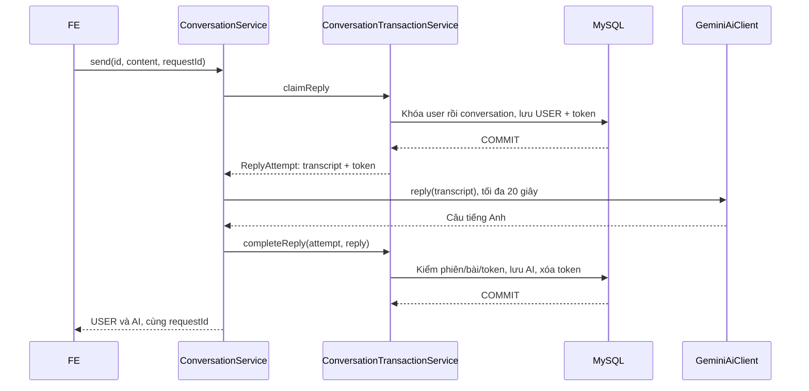

# 08 — Đọc code và chạy backend học tập

Cập nhật 26/10/2026. Backend đã triển khai 24 operation P0 của contract, gồm 9 auth và 15 operation học/chủ đề. Android học tập đã nối các API mới, có mic/TTS; trang admin static đã có. Xem [file 10](10-tich-hop-android-va-admin.md) để chạy và xem phạm vi kiểm chứng. Không đổi schema v3, không thêm bảng hoặc framework; dịch vụ/thiết bị thật còn cần nghiệm thu.

## 1. Cách lần theo code

Các đường dẫn Java bên dưới nằm trong `backend/src/main/java/vn/tailinh/speakmate/`.

| Thao tác | Bắt đầu đọc | Hàm xử lý và thay đổi dữ liệu |
| --- | --- | --- |
| Xem chủ đề | `controller/TopicController.java` | `TopicService.list`: chỉ topic đang bật, phân trang từ 1; không trả scenario |
| Admin thêm/sửa/tắt chủ đề | `controller/AdminTopicController.java` | `TopicService.create/update/setActive`: kiểm ADMIN trong transaction; chỉ đổi topics |
| Tạo bài | `controller/ConversationController.java` | `ConversationTransactionService.create`: khóa user, kiểm UUID, chép snapshot từ user/topic, INSERT conversations; chưa có tin nhắn |
| Xem lịch sử/bài | Cùng Controller | `ConversationTransactionService.list/get`: chỉ user hiện tại; `ConversationMapper` tính OPEN/CLOSED và pendingReply |
| Gửi một câu | `ConversationController.send` | `ConversationService.send` điều phối `claimReply` → `AiClient.reply` → `completeReply`; lỗi thì `failReply` |
| Kết thúc bài | `controller/ReviewController.java` | `ReviewService.finish` điều phối `ReviewTransactionService.claim` → `AiClient.review` → `complete`; lỗi thì `fail` |
| Xem báo cáo | `ReviewController.get` | `ReviewTransactionService.get`: đọc kết quả, tính canRetry; không gọi AI |
| Thử lại báo cáo | `ReviewController.retry` | `ReviewService.finish(id, true)`: claim mới nếu FAILED hoặc PROCESSING quá 90 giây; giữ endedAt |
| Chọn lưu từ | `controller/SavedWordController.java` | `SavedWordService.save`: kiểm toàn bộ quyền/trạng thái trước, copy word_suggestions sang saved_words; từ cũ giữ nghĩa cũ |
| Ôn từ | Cùng Controller | `SavedWordService.review`: đổi LEARNING/MASTERED, ghi thời gian server; thao tác lật thẻ không gọi API |

Entity chỉ ánh xạ bảng, Repository chỉ truy vấn, DTO xác định dữ liệu qua mạng. Mapper không gọi AI. `PageResponse` chuyển phân trang 1-based của API thành 0-based của Spring Data. `BusinessException` mang HTTP status/error cho nghiệp vụ; `GlobalException` bọc lỗi thống nhất.

Response DTO dùng `record`: Java tự tạo constructor và hàm đọc như `result.replyStatus()`. Record không có setter, phù hợp dữ liệu đã tính xong để trả FE. Entity vẫn dùng class/Lombok như phong cách backend cũ. `record` không phải một tầng kiến trúc hay thư viện mới.

## 2. Ba đoạn trong một lần gửi



`ConversationService` **không** có `@Transactional`. Hai hàm transaction nằm ở bean khác để Spring thực sự mở/đóng transaction khi gọi qua proxy. Nếu gọi một hàm `@Transactional` qua `this` trong cùng class thì annotation không tự tạo giao dịch mới như ta mong đợi.

`ReplyAttempt` là dữ liệu tạm trên request: ID bài, ID lượt, token xử lý, danh tính đã xác thực và transcript. Không phải Entity, không phải bảng. Service không giữ Entity rồi sửa sau khi chờ mạng.

USER commit trước nên AI lỗi vẫn giữ được câu vừa nói. Token kiểm quyền ghi kết quả của từng lần thử: ví dụ attempt A quá 90 giây, attempt B nhận token mới; A trả về muộn sẽ không ghi đè B. Một UUID người dùng dùng chung cho USER và AI; token backend đổi ở mỗi attempt và không trả FE.

Mọi transaction ghi của luồng này khóa user trước. Vì vậy hai request cùng user được xếp lần lượt ngay trước bước kiểm trùng; UNIQUE trong MySQL bảo vệ thêm ở tầng dữ liệu. Tạo bài/lưu từ đồng thời đã được kiểm thử theo cách này, không cần bắt exception rồi query tiếp trong transaction đã rollback.

## 3. Kết thúc và báo cáo

`ReviewTransactionService.claim` đọc transcript khi giữ khóa, đóng bài và vô hiệu reply cũ. Nếu có ít hơn 3 USER hoặc 30 từ tiếng Anh, trả INSUFFICIENT_DATA ngay. Đủ ngưỡng thì commit PROCESSING rồi mới gọi Gemini tối đa 45 giây. Đây là ngưỡng đủ dữ liệu cơ bản, không phải chứng nhận trình độ.

`PromptBuilder.reply` quy định nói chuyện tự nhiên, ngắn, không chấm/sửa trong bài. `PromptBuilder.review` yêu cầu nhận xét tiếng Việt, ví dụ/câu sửa tiếng Anh, căn cứ câu USER. Gemini trả JSON theo `backend/src/main/resources/ai/review-schema.json`; `ReviewValidator` còn kiểm giới hạn, ID đúng câu USER, không trùng và tính đầy đủ.

`ReviewTransactionService.complete` lưu tổng kết + câu sửa + từ gợi ý trong một transaction. Bất kỳ phần nào sai thì rollback toàn bộ; `fail` đánh FAILED trong transaction riêng, giữ endedAt và transcript. Câu gốc không bị thay bằng câu sửa. `ConversationMapper.message` không trả trường correction, kể cả khi mở lại transcript.

Khi sửa các hàm transaction, nhớ JPA có thể **flush trước một câu query**, không chỉ lúc commit. Đọc transcript trước khi sửa trạng thái; đặt đầy đủ trường bắt buộc trước query/flush tiếp theo. SQL có CHECK kiểm các trạng thái trung gian, nên không để entity ở dạng PROCESSING nhưng đã có nửa báo cáo.

## 4. Cấu hình Gemini và MySQL

1. Tạo API key tại [Google AI Studio](https://aistudio.google.com/api-keys); điền vào `backend/application-local.properties`, dòng `app.ai.api-key=`. Đây là Gemini key, khác Google OAuth Web client ID để đăng nhập.
2. Model mặc định `app.ai.model=gemini-3.5-flash-lite`. Có thể đổi model qua cấu hình mà không đổi Controller/DB. Key/model phải có quyền và quota tương ứng.
3. Điền `spring.datasource.password` cho MySQL của bạn. Tạo DB bằng [speakmate.sql](../../speakmate.sql) nếu cài mới; với DB cũ xem hướng dẫn migration trước.
4. Có thể chạy [seed năm chủ đề](../seeds/V1__topics.sql) trên database đã chọn. Seed chỉ thêm tên chưa có, giữ nội dung admin đã sửa, không có tài khoản/mật khẩu mặc định.
5. Chạy `./gradlew.bat bootRun` trong thư mục backend. Backend vẫn khởi động được khi chưa có Gemini key; gửi tin cần AI sẽ trả 503 AI_NOT_CONFIGURED và giữ USER để retry.

```properties
# Chỉ điền trong application-local.properties bị Git bỏ qua.
app.ai.api-key=YOUR_GEMINI_API_KEY
app.ai.model=gemini-3.5-flash-lite
```

Không chép chuỗi mẫu vào file local như key thật. Với triển khai có thể dùng `APP_AI_API_KEY` để ghi đè trực tiếp thuộc tính Spring; `GEMINI_API_KEY` là fallback nếu local không ghi giá trị cho thuộc tính này. Không đưa key vào Android, SQL hay URL.

Lựa chọn này dựa trên [model stable, độ trễ thấp và hỗ trợ structured output](https://ai.google.dev/gemini-api/docs/models/gemini-3.5-flash-lite), [mức miễn phí/chi phí](https://ai.google.dev/gemini-api/docs/pricing). Adapter dùng [generateContent REST](https://ai.google.dev/api/generate-content), JSON schema theo [structured outputs](https://ai.google.dev/gemini-api/docs/structured-output). Giá/quota/quyền model có thể thay đổi; kiểm trên project thực tế, không mặc định key nào cũng gọi được. Khả năng hội thoại/nhận xét phải thử bằng nội dung thật trước khi nghiệm thu.

## 5. Tạo admin và bàn giao FE

Đăng ký một tài khoản email riêng cho admin qua API. Trong MySQL, thay email mẫu bằng email vừa đăng ký, rồi đăng nhập lại sau khi nâng role:

```sql
UPDATE users
SET role = 'ADMIN', auth_version = auth_version + 1,
    refresh_token = NULL, refresh_expires_at = NULL
WHERE email = 'YOUR_ADMIN_EMAIL';
```

Không mở API cho người học tự gửi role. Dùng một USER khác cho Android do mỗi tài khoản chỉ có một phiên hiện hành. ADMIN vẫn không được xem bài riêng của người khác bằng API học tập.

Android đã nối `GET /topics` → `POST /conversations` → `POST .../messages` theo file 03. Gửi tin giữ nguyên UUID/content khi retry; khi nhận lỗi mạng/AI, GET detail trước. Tạo bài không có câu AI mở đầu. Chat dùng timeout 30 giây, finish/retry 60 giây. API đã kiểm tra bằng MySQL tạm; luồng học Android lấy server làm nguồn. STT/TTS và Gemini thật trên điện thoại vẫn cần nghiệm thu.

## 6. Chạy lại kiểm thử

Tại thư mục backend, trên Windows đã cài MySQL 8:

```powershell
powershell -NoProfile -ExecutionPolicy Bypass -File .\scripts\Test-MySql.ps1
```

Script tự tạo server riêng `127.0.0.1:13317/speakmate_test`, import bản SQL tạm, chạy `build mysqlTest`, dừng server, chờ tiến trình thoát rồi dọn datadir. Nó từ chối cổng đã có server, không dùng MySQL 3306 hay mật khẩu ứng dụng. Có thể truyền `-MySqlDirectory` nếu MySQL nằm ở nơi khác. Cần quyền ghi Gradle cache và quyền chạy process local.

`GeminiAiClientTest` kiểm adapter bằng HTTP mock; `ReviewValidatorTest` kiểm quy tắc báo cáo; `StudyIntegrationTest` dùng Security/JWT/JPA/MySQL thật, chỉ thay AiClient bên ngoài. Các test này không chứng minh Gemini thật nói tự nhiên, và không hoàn thành mốc M0/M1/M2 thay cho thử trên điện thoại.
