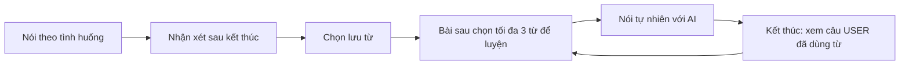

# 09 — Chiều sâu nghiệp vụ cho SpeakMate

**Tạm hoãn phần mở rộng dùng lại từ theo quyết định người phụ trách BE ngày 26/10/2026.** Hoàn thành P0 và tích hợp thiết bị thật trước; file này giữ làm tham khảo sau. Không thêm nghiệp vụ mới chỉ để tăng nội dung trình bày.

Cập nhật 26/10/2026 theo ưu tiên của người phụ trách backend: sản phẩm dùng được, có nội dung để giải thích, code đủ rõ để tự bảo vệ. Đây là đề xuất phát triển; phần mở rộng không tự trở thành API đã triển khai hoặc thay hợp đồng P0 1.0.0.

## 1. Điều muốn chứng minh

Người học luyện một tình huống cụ thể, nhận góp ý dựa trên câu mình đã nói và biết bước tiếp theo cần luyện. Từ đã lưu có thể được đem ra sử dụng trong tình huống sau. Cần chứng minh hành vi đó bằng app chạy thật và bằng chứng câu nói; chưa có cơ sở tuyên bố ứng dụng bảo đảm tăng trình độ.

Tham khảo sản phẩm: [ELSA AI](https://elsaspeak.com/en/ai/) tổ chức chọn tình huống → hội thoại → nhận xét sau đóng vai; [Speak Made For You](https://help.speak.com/en/articles/11565779-what-are-made-for-you-custom-lessons) có nội dung luyện dựa trên lỗi của người học. Đây là căn cứ tham khảo cách tổ chức trải nghiệm, không phải bằng chứng hiệu quả của SpeakMate.

## 2. Những cải tiến nhỏ đã làm ở lượt này

| Việc | File | Giới hạn cần hiểu |
| --- | --- | --- |
| Nội dung chủ đề có vai của người học và ba mục tiêu thực tế | `Docs/seeds/V1__topics.sql`, trường description đã có | Seed chỉ thêm tên chưa tồn tại, không tự sửa topic trong DB đang dùng; admin có thể sửa qua API |
| AI phản hồi theo nội dung, không kết thúc mọi lượt bằng một câu hỏi, điều chỉnh độ dài/từ vựng theo mức luyện | `service/ai/PromptBuilder.reply` | Đây là chỉ dẫn cho model, chất lượng thật phải thử bằng Gemini; chưa xác minh lời nói tự nhiên chỉ bằng code |
| Báo cáo ưu tiên 1–2 vấn đề có bằng chứng và một việc nhỏ để luyện tiếp | `service/ai/PromptBuilder.review` | Giữ schema/API hiện tại, dùng weaknesses/levelFeedback; validator kiểm cấu trúc và tham chiếu, không chứng minh nhận xét luôn đúng |
| Không khuyên hạ mức chỉ vì A1 chọn B2; không sửa câu đúng chỉ vì thích cách diễn đạt khác | Cùng review prompt | Vẫn cần ca kiểm chất lượng nội dung với AI thật |

Không thêm bảng/cột/endpoint trong những chỉnh sửa này. Mục tiêu chủ đề hiện là hướng dẫn hiển thị trước bài, chưa có bộ máy tự chấm đạt từng mục tiêu. Những nhận xét chỉ xuất hiện sau khi kết thúc.

## 3. Một phần mở rộng đáng làm nhất: dùng lại từ đã lưu

Ví dụ người học đã lưu **receipt**. Trước bài gọi cà phê kế tiếp, họ chọn luyện từ đó. AI tạo cơ hội phù hợp trong hội thoại nhưng không nhắc bài/cho điểm. Khi kết thúc, hệ thống cho biết người học đã dùng từ hay chưa và dẫn lại câu USER làm bằng chứng.

Đây là đề xuất, **chưa triển khai**. SQL v3 đã có bảng `word_practices`: mỗi dòng là một từ được chọn để luyện trong một bài. saved_words là từ cá nhân lâu dài; word_practices ghi mục tiêu/kết quả của từng lần luyện. Hai bảng có trách nhiệm khác nhau.

Quy tắc tối thiểu nếu triển khai:

1. Chọn 0–3 từ, không trùng, thuộc chính người dùng; không chọn vẫn luyện bình thường. Lưu word/meaning snapshot khi tạo bài, giữ nguyên khi retry cùng UUID.
2. Chỉ đánh giá sau Kết thúc. Lời AI có từ đó không được tính là người dùng đã dùng từ.
3. `USED` phải có evidence_message_id thuộc câu USER của cùng bài; kiểm có từ/cụm từ đã chọn trong câu, kiểm cách dùng theo ngữ cảnh. Không dùng phép tìm chuỗi con như `art` khớp `party` để quyết định kết quả.
4. Bản đầu chỉ nhận dạng dạng từ/cụm từ đã chọn theo ranh giới từ và không phân biệt hoa/thường. Các biến thể như go/went chưa được tự coi tương đương; không quảng cáo khả năng phân tích hình thái khi chưa có.
5. `NOT_USED` nghĩa là không ghi nhận được cách dùng hợp lệ trong bài theo phạm vi hỗ trợ, không khẳng định người học không biết từ. `UNVERIFIED` dùng khi thiếu dữ liệu hoặc kết quả chưa kiểm chứng được; không bịa bằng chứng để đủ báo cáo.
6. Tách được việc từ xuất hiện và việc AI đánh giá cách dùng phù hợp. Validator kiểm được phần bằng chứng; ngữ nghĩa vẫn có khả năng AI nhận xét sai. Nếu đánh giá không chắc chắn, dùng UNVERIFIED kèm giải thích.
7. Không tự đổi saved_words.status thành MASTERED chỉ vì dùng một lần. Kết quả luyện trong bài và tự đánh giá trí nhớ là hai nghiệp vụ khác nhau.
8. Nếu AI/báo cáo lỗi, giữ bài và từ mục tiêu để retry; không lưu nửa kết quả luyện/nửa báo cáo. Khi bài thiếu dữ liệu, kết quả từ cần trở về UNVERIFIED có lý do thay vì treo PENDING mãi.

Khi triển khai cần ánh xạ WordPractice, bổ sung DTO chọn từ khi tạo bài và trả kết quả cuối bài, mở rộng input/output AI, validator và transaction lưu báo cáo. Giữ các hàm này cụ thể; không cần thêm hệ thống khóa học, queue hoặc framework workflow. Không đổi contract âm thầm: phải cập nhật OpenAPI/examples/hướng dẫn FE cùng code.

## 4. Nhận xét dẫn đến một hành động

Ví dụ USER nói `I go to the coffee shop yesterday.`. Báo cáo hiển thị câu gốc, câu sửa `I went to the coffee shop yesterday.`, giải thích ngắn và gợi ý lần sau kể hai việc đã làm hôm qua. Đọc lại và luyện một bài mới là cách dùng các API hiện có; chưa cần bảng riêng cho từng loại lỗi.

Ưu điểm cũng cần bằng chứng, ví dụ người học đã diễn đạt được yêu cầu ít đường. Nếu câu đúng thì không tạo lỗi giả. Khuyến nghị trình độ là gợi ý luyện tập từ một bài, không phải điểm thi CEFR và không tự đổi hồ sơ.

## 5. Tiến độ hiển thị phải là số liệu thật

Nếu còn thời gian sau vòng học: số bài có báo cáo hoàn tất, số lượt USER, số từ đã lưu. Sau khi tính năng dùng lại từ hoạt động mới thêm số từ đã có bằng chứng sử dụng. Các số này có thể tổng hợp từ dữ liệu hiện có; không cần tạo bảng thống kê riêng ban đầu.

Không biến số bài/số từ thành tuyên bố đã tăng từ A1 lên B2. Hai bài khác chủ đề/độ khó hoặc thiếu dữ liệu không phải thước đo tiến bộ tương đương. So sánh câu gốc và cách nói ở bài luyện sau hữu ích hơn điểm phần trăm chưa có cách đánh giá rõ ràng.

## 6. Thứ tự triển khai phù hợp hai người và ba ngày

1. **Hoàn thành vòng P0 trên thiết bị thật:** topic → hội thoại AI → mic/TTS → kết thúc → review → lưu/ôn từ → lịch sử; admin quản lý nội dung. Đây vẫn là việc ưu tiên cao nhất vì Android học tập hiện còn demo.
2. **Thử chất lượng hội thoại và báo cáo:** dùng tình huống có mục tiêu; kiểm A1 chọn B2, câu đúng, câu sai, bài quá ngắn và lỗi mạng. Điền key Gemini/MySQL local để chạy thật; không đánh dấu hoàn thành bằng stub.
3. **Nếu P0 đã chạy ổn, bổ sung một phần mở rộng dùng lại từ** theo mục 3, giữ giới hạn ba từ và luật bằng chứng rõ ràng. Chưa cam kết phần này hoàn tất trong deadline P0.
4. **Sau cùng mới thêm thống kê gọn** nếu còn thời gian; ưu tiên sửa trải nghiệm/nhận xét trước trang trí.

## 7. Kịch bản trình bày có chiều sâu

Demo bản đang có sau khi tích hợp: chọn tình huống/mục tiêu → hội thoại vài lượt → ngắt mạng rồi retry mà không trùng tin → kết thúc → đối chiếu một câu gốc/câu sửa → lưu từ → mở lại lịch sử. Giải thích Controller nhận gì, Service kiểm gì, transaction nào ghi bảng nào.

Khi phần dùng lại từ đã triển khai, thêm một lượt demo: chọn receipt → dùng `Can I have the receipt, please?` → kết thúc → mở đúng câu USER làm bằng chứng. Chỉ trình bày là hành vi đã có khi chạy được thật; hiện đây là kịch bản dự kiến.

Các câu có thể giải thích bằng code: vì sao góp ý sau bài; vì sao hai message cùng requestId; vì sao đóng bài trước khi chờ báo cáo; vì sao token cũ không ghi đè; vì sao lưu từ và luyện từ là hai nghiệp vụ; vì sao một lần dùng từ chưa đồng nghĩa MASTERED. Các chi tiết này tạo nội dung bảo vệ ngay trong một vòng học nhỏ.
