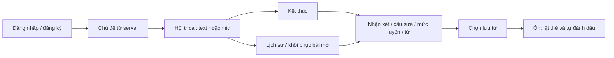

# 10 — Chạy vòng học Android và trang admin

Cập nhật 26/10/2026. Theo quyết định của người phụ trách BE: hoàn thiện phạm vi P0 trước, tạm hoãn luyện dùng lại từ và các mở rộng trong file 09. Không thêm bảng, không đổi hợp đồng API 1.0.0 trong đợt tích hợp này.

## 1. Luồng đã nối trong code



Đăng ký/khôi phục mật khẩu đã có form Android. Google giữ nút lựa chọn riêng. Các màn P0 lấy dữ liệu từ server; không còn tạo lời chào AI, câu trả lời, nhận xét hoặc danh sách từ cố định trong các màn này. Tạo bài có transcript rỗng; người học bắt đầu trước.

Luồng ôn dùng một danh sách **Từ của tôi**, không cần chọn bộ thẻ. Các file deck/demo cũ vẫn giữ trong source để tránh xóa công việc UI trước đó, nhưng không được MainActivity/FlashcardsFragment dùng làm nguồn hoặc đường điều hướng P0.

## 2. Bản đồ file Android

Đường dẫn dưới đây tương đối với `frontend/app/src/main/java/com/example/speakmate/`.

| File | Trách nhiệm |
| --- | --- |
| LoginActivity, AccountActivity | Đăng nhập Google/email; đăng ký; xin mã và đặt lại mật khẩu; không lưu mật khẩu/mã vào Bundle |
| auth/AuthApi | Public account endpoints, không gắn token cũ vào login/refresh/register/forgot/reset |
| auth/SessionManager | Một nơi đọc/ghi SessionStore, refresh một lần khi gặp 401; khóa riêng đoạn refresh, không khóa suốt cuộc gọi AI |
| api/ApiClient, api/BackendHttpApi | Retrofit/OkHttp cho HTTP JSON, mã lỗi, Bearer token, giới hạn kích thước phản hồi; timeout theo operation |
| api/LearningApi | URL/body cho API học; send 30 giây, finish/retry 60 giây; các GET thông thường 15 giây |
| api/PendingRequests | Lưu UUID/body trước khi gọi mạng, tách theo user, trong no-backup directory; khôi phục sau đóng/mở app |
| ui/NetworkFragment | Chạy mạng trên worker; bỏ callback của view đã bị hủy; hai worker cho phép End khi send đang chờ |
| ui/Ui, res/layout/view_learning_page.xml | Khung XML dùng chung và native controls động theo màu hiện tại; không có nghiệp vụ DB/AI |
| SpeakingFragment | GET topics, chọn mức độc lập, tạo/khôi phục bài bằng cùng createRequestId |
| ChatFragment | Đọc transcript server, gửi/retry đúng UUID, pendingReply/poll, End, khôi phục khi mở lại |
| speech/SpeechController | Mic tiếng Anh, đọc lời AI, dừng khi rời màn hình; loại callback của mic/TTS cũ |
| SpeakingResultFragment | GET review, PROCESSING/FAILED/INSUFFICIENT_DATA/COMPLETED, retry rõ ràng, câu sửa và chọn lưu từ |
| FlashcardsFragment, SavedWordStudyFragment | Danh sách từ theo tài khoản; lật thẻ không gọi API; Chưa nhớ/Đã nhớ gọi PATCH ghi lần ôn |
| HistoryFragment | Lịch sử theo tài khoản; bài OPEN mở chat, bài CLOSED mở report |
| HomeFragment | Số bài đã tạo và số từ tự đánh dấu MASTERED lấy từ meta của API, không dùng số demo |

## 3. Những tình huống app xử lý

Theo root AGENTS.md, Android dùng Retrofit. BackendHttpApi chỉ định GET/POST/PATCH; ApiClient xử lý response JSON và lỗi chung. SessionManager và các màn hình giữ nguyên nghiệp vụ. Retrofit 3.0.0 dùng RequestBody/ResponseBody để giữ JSON hiện có; không thêm một luồng refresh song song. OkHttp chia sẻ connection pool; tự retry mạng được tắt để thao tác ghi đi qua UUID/GET/retry rõ ràng của app.

- Mất response sau khi gửi: giữ UUID/content trong PendingRequests, GET bài trước rồi mới retry; không tạo mã mới chỉ vì mạng lỗi.
- App bị đóng khi tạo bài: màn Chủ đề có nút khôi phục thao tác tạo còn chưa rõ kết quả.
- Bài đang chờ AI: GET định kỳ khi còn ở màn hình; không phát toàn bộ lời AI cũ khi mở lại lịch sử.
- End khi reply chưa về: ngừng mic/TTS; backend đóng trước và loại lời AI muộn. Nếu review lỗi vẫn mở lại được bài/report để retry.
- Phiên hết hạn: các màn chia sẻ một refresh, lưu cặp token mới; lỗi mạng không tự xóa phiên. Phiên bị thu hồi thì yêu cầu đăng nhập lại.
- Không có mic engine, thiếu quyền hoặc giọng đọc chưa sẵn sàng: giữ cách nhập/đọc text. Không tự coi đây là lỗi mất bài.
- TTS và mic không chạy cùng nhau; stop/background/hủy view vô hiệu callback cũ. Mic nhận dạng xong có thể gửi ngay; trong Âm thanh có thể tắt tự gửi và tự đọc.

Voice dùng [Android SpeechRecognizer](https://developer.android.com/reference/android/speech/SpeechRecognizer) và [TextToSpeech](https://developer.android.com/reference/android/speech/tts/TextToSpeech), cần quyền mic và dịch vụ tương ứng trên thiết bị. Nhận dạng có thể phụ thuộc mạng/engine; chưa có tính năng chấm phát âm hoặc lưu audio trong DB.

## 4. Chạy trên máy của nhóm

1. Cấu hình MySQL/JWT/Gemini theo [file 08](08-doc-code-va-chay-backend.md). File thật `backend/application-local.properties` bị Git bỏ qua; không đưa API key/mật khẩu vào Android/chat/Git.
2. Với DB mới, import [speakmate.sql](../../speakmate.sql). Với DB cũ, làm theo hướng dẫn migration; không cài mới chồng dữ liệu. Có thể thêm [năm chủ đề](../seeds/V1__topics.sql) vào database đã chọn.
3. Trong backend chạy `./gradlew.bat bootRun`.
4. Trong `frontend/local.properties` điền URL. Emulator dùng `speakmate.api.baseUrl=http://10.0.2.2:8081/`; điện thoại thật dùng IP LAN của máy backend, cùng mạng. Giữ dòng sdk.dir hiện có. Google Web client ID cấu hình theo tài liệu tài khoản.
5. Trong frontend chạy `./gradlew.bat assembleDebug`, cài `app/build/outputs/apk/debug/app-debug.apk`. Đổi URL/client ID cần build lại. Bản release yêu cầu URL HTTPS; debug mới cho phép HTTP.
6. Đăng ký USER, vào Luyện hội thoại, chọn topic, thử ít nhất ba lượt có tổng tối thiểu 30 từ tiếng Anh rồi kết thúc. Kiểm tra nhận xét, chọn lưu từ và mở Từ của tôi để ôn.

## 5. Trang admin

Mở `http://localhost:8081/admin/index.html` khi backend chạy. File ở `backend/src/main/resources/static/admin/`:

- `index.html`: form login, form chủ đề, danh sách/phân trang.
- `admin.js`: auth/refresh, gọi 5 API chủ đề; render bằng textContent; token chỉ ở bộ nhớ trang.
- `admin.css`: bố cục gọn trên trình duyệt.

Tạo ADMIN riêng theo file 08; không dùng cùng tài khoản USER trên Android vì mỗi tài khoản có một phiên hiện hành. Trang tải được khi chưa đăng nhập, nhưng `/api/v1/admin/**` vẫn kiểm ADMIN. Thêm/sửa/bật/tắt không xóa lịch sử bài cũ. Tải lại trang cần đăng nhập lại; đây là cách giữ phiên đơn giản cho bản ba ngày.

## 6. Kiểm chứng và giới hạn

Backend tiếp tục qua `build mysqlTest`: 75 unit + 27 MySQL/API test. Đã bổ sung kiểm tra tài nguyên admin tải công khai trong khi API admin vẫn trả 401/403 cho người không đủ quyền.

Android có các test thao tác trên API 35. Test học dùng HTTP fixture cục bộ trong **androidTest**, không có fixture/model giả trong app chính. Fixture mô phỏng mất response sau khi ghi lượt, polling báo cáo và PATCH lần ôn. Có test form đăng ký/reset, refresh đồng thời và UUID tách theo tài khoản.

Kết quả ngày 26/10/2026 sau chuyển lớp HTTP sang Retrofit: `connectedDebugAndroidTest` đạt **7 test, 0 lỗi, 0 bỏ qua**. Luồng UI kiểm đăng nhập → chủ đề → ba lượt chat (mất một response) → tạo lại Activity/khôi phục transcript → review PROCESSING/COMPLETED → chọn lưu từ → ôn MASTERED → lịch sử. Có thêm kiểm form đăng ký/reset, một refresh cho hai request cùng hết hạn và UUID lưu theo user.

Chạy test fixture trên một emulator đang bật:

```powershell
cd frontend
.\gradlew.bat connectedDebugAndroidTest '-Pspeakmate.api.baseUrl=http://127.0.0.1:18080/'
```

Port 18080 ở đây nằm **trong emulator**, do test tạo ServerSocket; không phải backend nhóm. Không dùng cấu hình này cho bản APK giao nhóm. Sau test, build lại không có `-P` để APK lấy URL từ local.properties:

```powershell
.\gradlew.bat assembleDebug lintDebug
```

Báo cáo Android: `frontend/app/build/reports/androidTests/connected/debug/index.html`; lint: `frontend/app/build/reports/lint-results-debug.html`. Báo cáo backend tại `backend/build/reports/tests/`.

Bản giao đã build lại bằng `assembleDebug lintDebug` không có cấu hình fixture; lệnh thành công. APK nằm tại `frontend/app/build/outputs/apk/debug/app-debug.apk`, lấy URL server từ local.properties. Máy Android thử và MySQL tạm đã được dừng sau kiểm tra; không đổi dữ liệu MySQL 3306. Các liên kết tài liệu đã chuyển sang thư mục `Docs/Contract` hiện tại.

Các kết quả fixture/MySQL riêng chưa chứng minh Android đã nói chuyện với Gemini thật. Cần xác nhận thêm: DB nhóm, key/quota Gemini, Google OAuth thật, email SMTP thật, và nói/nghe trên điện thoại demo. M0–M3 chưa được tự đánh dấu hoàn tất chỉ từ kết quả test này. Phần dùng lại từ/đánh giá tiến bộ nâng cao tiếp tục tạm hoãn.
