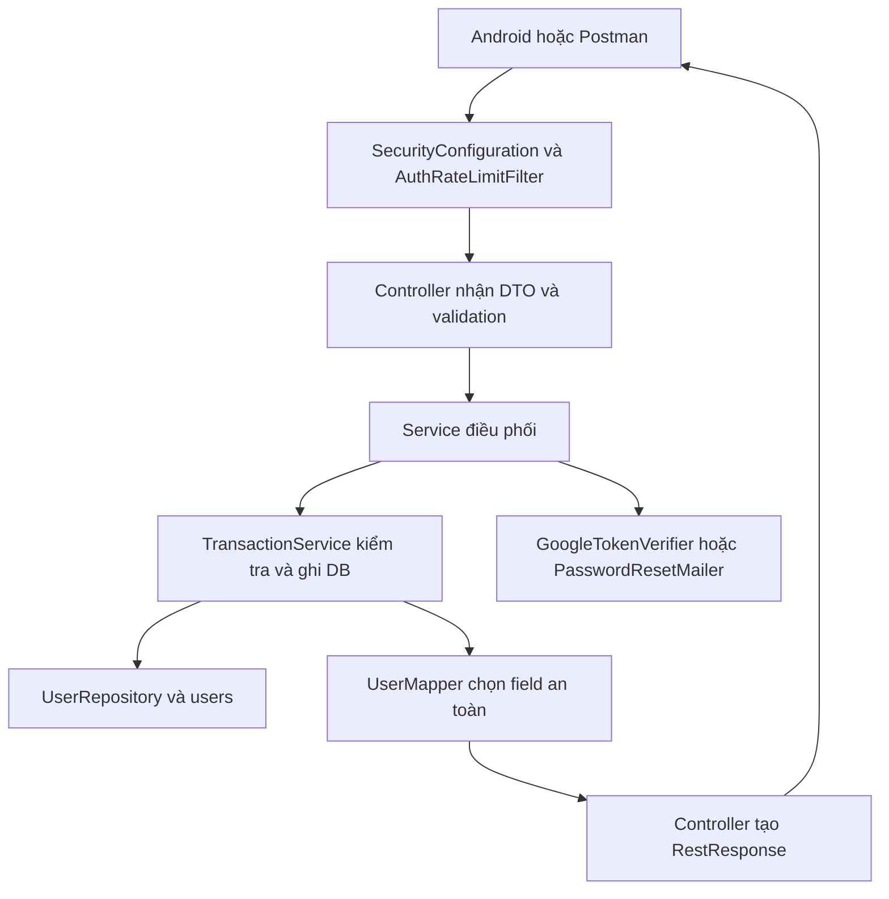

# SpeakMate — Luồng tài khoản và bản đồ code

Cập nhật 29/10/2026. Backend đã có đăng ký, đăng nhập mật khẩu, đăng nhập/liên kết Google, refresh, đăng xuất, hồ sơ hiện tại, quên và đặt lại mật khẩu. Android đã có các form tài khoản, nút “Tiếp tục với Google”, khôi phục phiên và hồ sơ/liên kết Google/đăng xuất. Vòng học text trên Android đã được kiểm với MySQL/Gemini thật; Google, SMTP và giọng nói thật vẫn cần nghiệm thu. Mục 5–6 hướng dẫn cấu hình từng bước. Xem [kiểm chứng môi trường thực tế](Contract/11-kiem-chung-moi-truong-thuc-te.md) để phân biệt test mock với dịch vụ thật.

## 1. Bắt đầu bằng bốn quy tắc

1. Người dùng là một dòng `users`. USER/ADMIN dùng cùng cơ chế đăng nhập; đăng ký luôn tạo USER.
2. Mật khẩu lưu BCrypt. Google dùng `google_subject` lấy từ `sub` đã xác minh. Tài khoản Google mới có `password = NULL`.
3. Mỗi tài khoản có một phiên hiện hành. Đăng nhập trên thiết bị mới làm phiên cũ mất hiệu lực. Đây là lựa chọn phạm vi v1, không phải hỗ trợ nhiều thiết bị.
4. Quên mật khẩu gửi mã qua email, rồi đổi mật khẩu. Không gửi mật khẩu, không trả mã trong response, không tự đăng nhập sau khi đổi.

Đăng ký email hiện chưa có bước xác minh email riêng. Nó chỉ tạo thông tin đăng nhập; không được trình bày là đã xác minh chủ hộp thư. Khôi phục mật khẩu chứng minh quyền nhận email tại thời điểm khôi phục.

## 2. Request đi qua đâu?



Đường gọi Google/gửi email nằm **ngoài transaction DB**. Vì vậy có Service điều phối và TransactionService riêng: Spring mở/đóng transaction khi gọi bean thứ hai. Đây không phải hai bản sao nghiệp vụ.

Các đường dẫn dưới tương đối với `backend/src/main/java/vn/tailinh/speakmate/`:

| File | Bạn tìm ở đây khi muốn hiểu/sửa gì? |
| --- | --- |
| `controller/AuthController.java` | URL, HTTP status, nhận DTO, bọc kết quả |
| `controller/PasswordResetController.java` | Hai URL quên/đặt lại mật khẩu |
| `dto/request/auth/*` | Field client được gửi và validation hình thức |
| `dto/response/auth/UserResponse.java` | Hồ sơ an toàn; không có password/hash/mã khôi phục |
| `dto/response/auth/TokenResponse.java` | access_token, refresh_token, expires_in, token_type, user |
| `service/AuthService.java` | Gọi xác minh Google trước khi vào transaction; chuyển yêu cầu đến nghiệp vụ |
| `service/AuthTransactionService.java` | Đăng ký, kiểm mật khẩu, cấp phiên, refresh, logout, liên kết Google |
| `service/TokenService.java` | Tạo JWT, tạo refresh ngẫu nhiên, băm refresh bằng SHA-256 |
| `service/PasswordPolicy.java` | Mật khẩu 8–64 ký tự, không quá 72 byte UTF-8 vì dùng BCrypt; không tự trim mật khẩu |
| `service/UserService.java` | Lấy ID/version từ JWT đã xác minh, tải tài khoản hiện tại |
| `service/PasswordResetService.java` | Đưa việc gửi email vào hàng đợi nhỏ, gọi transaction, chuyển kết quả thành lỗi HTTP |
| `service/PasswordResetTransactionService.java` | Cấp mã, giới hạn yêu cầu, đếm sai, đổi mật khẩu và thu hồi phiên |
| `service/google/GoogleTokenVerifier.java` | Xác minh chữ ký và claims Google; không tự ghi users |
| `service/mail/SmtpPasswordResetMailer.java` | Tạo nội dung email và gọi SMTP; không truy vấn DB |
| `repository/UserRepository.java` | Truy vấn và khóa dòng khi thay phiên/mã khôi phục |
| `util/mapper/UserMapper.java` | Chọn field Entity được phép trả cho app |
| `config/SecurityConfiguration.java` | URL công khai, quyền ADMIN, BCrypt, JWT, Clock và executor gửi email |
| `security/DatabaseJwtAuthenticationConverter.java` | Sau kiểm chữ ký, kiểm user còn hoạt động và auth_version còn đúng; lấy role từ DB |
| `security/AuthRateLimitFilter.java` | Giới hạn các POST auth: 30 yêu cầu/phút/IP trên một tiến trình |
| `exception/GlobalException.java` | Lỗi trong MVC: validation, nghiệp vụ, DB |
| `security/SecurityErrorHandler.java` | Lỗi 401/403 trước khi đến Controller |

`@Transactional` và audit là hai phần Spring/JPA gọi gián tiếp. `@PrePersist/@PreUpdate` lấy email người đã xác thực, nếu không có thì `system`. Request không được tự gửi field audit. Response được bọc ngay trong Controller, nhìn thấy bằng `RestResponse.success(...)`; chưa dùng ResponseBodyAdvice.

## 3. Contract API

Base URL local: `http://localhost:8081/api/v1/auth`. Trên Android emulator, địa chỉ máy chạy backend là `http://10.0.2.2:8081`; thiết bị thật dùng IP LAN của máy. Cấu hình mạng/cleartext phục vụ phát triển nằm phía Android; khi triển khai dùng HTTPS.

| Method/path | Body JSON | Kết quả |
| --- | --- | --- |
| POST `/register` | `{"name":"An","email":"an@example.com","password":"your-own-password","level":"A1"}` | 201, hồ sơ; level có thể bỏ |
| POST `/login` | `{"email":"an@example.com","password":"your-own-password"}` | 200, cặp token |
| POST `/google` | `{"idToken":"GOOGLE_ID_TOKEN"}` | 200, cặp token; tự tạo user nếu đủ điều kiện |
| POST `/refresh` | `{"refreshToken":"CURRENT_REFRESH_TOKEN"}` | 200, cặp token mới |
| GET `/me` | Không có body; Bearer access token | 200, hồ sơ |
| POST `/logout` | Không cần body; Bearer access token | 200, thu hồi phiên |
| POST `/google/link` | `{"idToken":"GOOGLE_ID_TOKEN"}` và Bearer access token | 200, liên kết Google có email trùng tài khoản hiện tại |
| POST `/password/forgot` | `{"email":"an@example.com"}` | 202, thông báo chung |
| POST `/password/reset` | `{"email":"an@example.com","code":"123456","newPassword":"your-new-password"}` | 200, yêu cầu đăng nhập lại |

Các chuỗi mẫu là chỗ thay thế, không phải tài khoản/mã được tạo sẵn. Trường ngoài DTO như role/id/is_active bị từ chối 400.

Kết quả login/Google/refresh:

```json
{
  "statusCode": 200,
  "error": null,
  "message": "Đăng nhập thành công",
  "data": {
    "access_token": "...",
    "refresh_token": "...",
    "token_type": "Bearer",
    "expires_in": 900,
    "user": {"id": 1, "name": "An", "email": "an@example.com", "level": "A1", "role": "USER", "active": true, "passwordEnabled": true, "googleLinked": false}
  }
}
```

Request được bảo vệ gửi `Authorization: Bearer <access_token>`. Các endpoint công khai như login/refresh không cần header này; tránh tự gắn access token đã hết hạn vào mọi request. Refresh chỉ gửi trong body `/refresh`. Android lưu token an toàn, không ghi log; chỉ cho một yêu cầu refresh chạy tại một thời điểm và thay cả cặp token sau thành công. Refresh trả 401 thì xóa phiên và quay về đăng nhập.

| HTTP | Cách xử lý chính |
| --- | --- |
| 400 | Sửa dữ liệu hoặc xin mã khôi phục mới nếu INVALID_RESET_CODE |
| 401 | Sai thông tin đăng nhập/token hết hạn hoặc đã bị thu hồi |
| 403 | Tài khoản bị khóa sau khi kiểm đúng mật khẩu, hoặc thiếu quyền ADMIN |
| 409 | Email trùng; GOOGLE_LINK_REQUIRED yêu cầu đăng nhập hiện có rồi liên kết |
| 429 | Chờ theo Retry-After; không tự lặp request liên tục |
| 503 | Google/SMTP chưa cấu hình, Google tạm không xác minh được hoặc hàng đợi email đầy |

## 4. Vòng đời phiên để giải thích với thầy

Ví dụ user có `auth_version = 2`. Đăng nhập đúng tăng lên 3. JWT có `sub = id`, `auth_version = 3`, hạn 15 phút, issuer/audience/token_type riêng. Refresh ngẫu nhiên có phần ID để tìm user và 32 byte ngẫu nhiên; DB chỉ giữ hash và hạn 7 ngày.

Mỗi request kiểm chữ ký/hạn JWT, rồi đối chiếu `users.is_active` và version trong DB. Vai trò cũng lấy từ DB. Vì vậy khóa tài khoản, đổi role hoặc thu hồi phiên có tác dụng ở request tiếp theo. Đây là JWT có kiểm tra trạng thái DB, không phải hệ thống hoàn toàn không truy vấn DB.

Refresh khóa dòng user, kiểm hash và hạn, thay refresh token và hạn; giữ version của phiên. Hai request dùng cùng token thì chỉ một request thành công. Login mới tăng version và thay refresh. Logout/đặt lại mật khẩu tăng version và xóa refresh + hạn. Không cần danh sách đen riêng.

SHA-256 phù hợp refresh vì token có độ ngẫu nhiên cao. Mật khẩu và mã 6 chữ số có không gian đoán nhỏ nên dùng BCrypt; mã còn có hạn và giới hạn 5 lần sai. JWT được ký, không mã hóa, nên không chứa bí mật cá nhân.

## 5. Google: cấu hình sau khi có tài khoản phát triển

Trải nghiệm người dùng: mở SpeakMate → màn hình Đăng nhập → bấm **Tiếp tục với Google** → hộp chọn tài khoản do Google hiển thị → chọn tài khoản → backend xác minh và cấp phiên SpeakMate → Trang chủ. Lần đầu tự tạo tài khoản A1/USER nếu email chưa có tài khoản SpeakMate. Không yêu cầu nhập mật khẩu Google vào form của SpeakMate.

Luồng dùng **OpenID Connect ID token** trên nền OAuth 2.0: Android mở lựa chọn tài khoản bằng Credential Manager, lấy ID token cho backend, POST `/google`. SpeakMate xác minh token rồi cấp phiên riêng. Không nhận email/Google ID do app tự khai thay cho token đã ký. Google hướng dẫn kiểm chữ ký, aud, iss, exp và dùng sub làm định danh. [Tài liệu xác minh Google](https://developers.google.com/identity/gsi/web/guides/verify-google-id-token).

Thao tác cấu hình cho bản demo (cập nhật 29/10/2026):

1. Mở [Google Cloud Console](https://console.cloud.google.com/), chọn hoặc tạo project SpeakMate. Có thể dùng cùng project Gemini; OAuth client là cấu hình riêng với Gemini API key.
2. Vào **Google Auth Platform** (hoặc **APIs & Services → OAuth consent screen**) → **Get started**. Điền tên SpeakMate, email hỗ trợ/liên hệ; chọn **External** nếu dùng Gmail cá nhân. Trong **Audience**, thêm các email dùng demo vào **Test users** nếu giao diện có mục này và ứng dụng đang Testing.
3. Tại thư mục `frontend`, chạy lệnh dưới đây. Tìm phần **Variant: debug**, sao chép giá trị **SHA1** của đúng máy build APK; không lấy SHA-256.

```powershell
$env:JAVA_HOME = 'C:\Program Files\Java\jdk-21'
.\gradlew.bat signingReport --no-daemon --console=plain `
    '-Dorg.gradle.java.home=C:\Program Files\Java\jdk-21' `
    '-Dorg.gradle.java.installations.paths=C:\Users\PC\.gradle\jdks\eclipse_adoptium-25-amd64-windows.2,C:\Program Files\Java\jdk-21'
```

4. Trong **Clients → Create client**, tạo loại **Android**, đặt tên SpeakMate Debug, package **`com.example.speakmate`**, dán SHA-1 vừa lấy. Khi FE build trên máy khác, thêm Android client với SHA-1 của máy đó trong cùng project; bản release cần khóa ký release.
5. Tạo tiếp client loại **Web application** trong cùng project, đặt tên SpeakMate Backend; để trống JavaScript origins/redirect URIs cho luồng ID token hiện tại. Sao chép **Client ID**. Không cần Firebase, client secret hay callback mới. Đây là hai loại client theo [codelab Google](https://codelabs.developers.google.com/sign-in-with-google-android).
6. Điền **cùng Web client ID** vào hai file dưới đây. Giữ nguyên các dòng MySQL/Gemini/JWT đã có, lưu file rồi khởi động lại backend từ thư mục `backend` trên cổng 8081:

```properties
app.auth.google-client-id=YOUR_WEB_CLIENT_ID.apps.googleusercontent.com
```

Điền cùng Web client ID trong `frontend/local.properties` (file đã được Git bỏ qua), rồi Sync/Build lại Android:

```properties
speakmate.google.webClientId=YOUR_WEB_CLIENT_ID.apps.googleusercontent.com
speakmate.api.baseUrl=http://10.0.2.2:8081/
```

URL trên dành cho máy ảo truy cập backend trên máy tính. Điện thoại thật dùng IP LAN máy tính; release dùng URL HTTPS. Bản debug cho HTTP để thử local; release chặn HTTP. Client ID không phải client secret; không điền client secret vào Android. Có thể lấy SHA-1 bằng `gradlew signingReport` trong frontend. Không tự tạo Client ID giả khi chưa có cấu hình Google Cloud.

7. Sync/Build lại Android sau khi sửa `frontend/local.properties` vì client ID được đóng vào BuildConfig. Cài APK mới trên điện thoại hoặc emulator có **Google Play services** và đã đăng nhập tài khoản Google. Mở SpeakMate → **Tiếp tục với Google** → chọn tài khoản. Việc cần có tài khoản trên thiết bị được nêu trong [hướng dẫn Google](https://codelabs.developers.google.com/sign-in-with-google-android).

Nghiệm thu: Google với email mới vào Home; đăng xuất rồi Google lại vẫn cùng ID/lịch sử. Với email đã đăng ký mật khẩu, đăng nhập mật khẩu trước → **Cá nhân → Liên kết Google** bằng cùng email → đăng xuất → thử Google. Bấm hủy chọn tài khoản phải trở về form bình thường.

| Hiện tượng | Kiểm tra tại máy |
| --- | --- |
| App báo Google chưa sẵn sàng | `speakmate.google.webClientId` đã lưu và APK đã build lại chưa |
| Backend trả `GOOGLE_NOT_CONFIGURED` | `app.auth.google-client-id` và thư mục chạy backend; restart sau khi sửa |
| Không thấy tài khoản / không mở được hộp chọn | Thiết bị đã có tài khoản Google, Play services và kết nối Internet |
| Token bị từ chối | Hai nơi cùng **Web** client ID; Android client cùng project, đúng package/SHA-1; ngày giờ thiết bị đúng |
| `GOOGLE_LINK_REQUIRED` | Dùng luồng liên kết cùng email, giữ tài khoản/lịch sử hiện có |

### Code Android của nút Google

Các đường dẫn sau tương đối với `frontend/app/src/main/java/com/example/speakmate/`:

| File | Trách nhiệm |
| --- | --- |
| `LoginActivity.java` | Hiện hai cách đăng nhập, validation, chờ/lỗi; chỉ vào Trang chủ sau response thành công |
| `auth/GoogleSignInHelper.java` | `GetSignInWithGoogleOption` + Credential Manager mở hộp chọn Google, lấy ID token; xử lý hủy và dọn trạng thái khi đăng xuất |
| `auth/AuthApi.java` | Gửi ID token qua `/api/v1/auth/google`; gọi login/me/refresh/link/logout trên worker thread |
| `auth/AuthSession.java` | Cặp token SpeakMate và hồ sơ an toàn nhận từ backend |
| `auth/SessionStore.java` | Mã hóa phiên bằng AES-GCM, khóa trong Android Keystore; file nằm ngoài backup; không lưu Google ID token |
| `MainActivity.java` | Chặn vào màn hình chính khi chưa có phiên |
| `ProfileFragment.java` | Hồ sơ, liên kết Google tường minh và đăng xuất/đổi tài khoản |

Giao diện nằm ở `res/layout/activity_login.xml` và `fragment_profile.xml`. Cấu hình local được Gradle đưa vào BuildConfig. Nhấn Google gọi `GoogleSignInHelper.signIn` → callback ID token → `AuthApi.google` → backend → `SessionStore.save` → MainActivity. Đóng/mở app gọi `/me`; access hết hạn thì refresh và lưu cặp token mới. Lỗi kết nối giữ phiên để thử lại; phiên bị thu hồi đưa người dùng về đăng nhập.

Luồng nút bấm dùng API chính thức dành cho Sign in with Google button, không tự vẽ hộp chọn danh tính. Xem [hướng dẫn Credential Manager](https://developer.android.com/identity/sign-in/credential-manager-siwg-implementation). Biểu tượng G lấy từ [tài nguyên chính thức Google](https://developers.google.com/identity/branding-guidelines).

Backend chỉ chấp nhận chữ ký RS256 từ khóa công khai Google, đúng issuer/audience, còn hạn, email_verified=true và sub hợp lệ. Chưa triển khai challenge nonce dùng một lần; ID token cần được giữ kín và truyền HTTPS. Không dùng Google access token hoặc mã authorization code thay cho ID token.

Nếu email đã có tài khoản mật khẩu, `/google` trả 409. Người dùng đăng nhập tài khoản đó rồi gọi `/google/link`, email hai bên phải trùng. Cách này tránh tự gộp hai danh tính chỉ dựa trên email. Google-only không có mật khẩu SpeakMate, dùng nút Google để quay lại; quên mật khẩu không tạo mật khẩu cho tài khoản này.

## 6. Quên mật khẩu: từ request đến email

```mermaid
sequenceDiagram
    participant App
    participant Service as PasswordResetService
    participant Tx as PasswordResetTransactionService
    participant DB as users
    participant SMTP
    App->>Service: POST forgot(email)
    Service-->>App: 202 thông báo chung
    Note over Service: Tác vụ gửi chạy trong executor nhỏ
    Service->>Tx: issueCode(email)
    Tx->>DB: Khóa user, kiểm 60 giây, lưu hash + hạn
    Tx-->>Service: Dữ liệu gửi nội bộ, transaction đã commit
    Service->>SMTP: Gửi mã
    App->>Service: POST reset(email, code, newPassword)
    Service->>Tx: verifyAndReset
    Tx->>DB: Mã sai: tăng attempts; đúng: đổi hash, xóa mã, thu hồi phiên
    Tx-->>Service: true/false sau commit
    Service-->>App: 200 hoặc 400
```

Thông báo 202 giống nhau cho email chưa có, tài khoản bị khóa, Google-only, đang trong 60 giây chờ hoặc yêu cầu được nhận. Nó không cam kết email đã gửi thành công. Mã có 6 chữ số, hạn 10 phút, tối đa 5 lần sai; yêu cầu mã mới sau thời gian chờ sẽ thay mã cũ. Thành công chỉ dùng một lần. Sai mã trả false trong transaction để bộ đếm được commit, rồi Service ngoài transaction mới ném lỗi HTTP.

SMTP lỗi: xóa mã vừa cấp nếu nó vẫn là mã hiện hành, giữ thời điểm cấp để không bỏ qua cooldown. Người dùng thử xin mã lại sau 60 giây. Hàng đợi ở bộ nhớ, một worker, tối đa 50 tác vụ; restart có thể làm mất tác vụ chưa gửi. Đây là giới hạn được chấp nhận cho một backend v1, chưa có hàng đợi bền vững. Không có SMTP thì trả 503 như nhau cho mọi email; backend vẫn khởi động và các API khác vẫn chạy.

Thiết lập Gmail cho bản demo:

1. Chọn hộp Gmail mà bạn sở hữu để **gửi** mã (có thể khác email nhận). Mở [Google Account](https://myaccount.google.com/) → **Security → 2-Step Verification**, bật xác minh hai bước.
2. Mở [App passwords](https://myaccount.google.com/apppasswords), tạo mật khẩu ứng dụng tên SpeakMate Backend. Tự điền giá trị vừa tạo vào file local, không gửi qua chat hoặc chụp màn hình chứa nó. Nếu Google hiển thị theo nhóm, nhập liền chuỗi khi lưu properties.
3. Nếu không thấy App passwords, kiểm tra điều kiện tài khoản; tài khoản tổ chức, Advanced Protection hoặc chỉ dùng security key có thể không có tùy chọn này. Dùng SMTP mà tài khoản cho phép. Xem [hướng dẫn chính thức](https://support.google.com/accounts/answer/185833).

Điền vào `backend/application-local.properties`, bỏ dấu `#` ở các dòng SMTP tương ứng:

```properties
spring.mail.host=smtp.gmail.com
spring.mail.port=587
spring.mail.username=YOUR_SENDER@gmail.com
spring.mail.password=YOUR_APP_PASSWORD
app.mail.from=YOUR_SENDER@gmail.com
```

Timeout và STARTTLS đã cấu hình trong application.properties. Cổng 587 dùng TLS theo [tài liệu SMTP của Gmail](https://developers.google.com/workspace/gmail/imap/imap-smtp). Không dùng mật khẩu đăng nhập Gmail thông thường. SMTP của nhà cung cấp khác cần host/port/cơ chế TLS đúng tài liệu nhà cung cấp.

4. Lưu file, khởi động lại backend tại thư mục `backend`. SMTP chỉ ở BE, không cần đưa thông tin này vào Android hoặc rebuild APK.
5. Trên app, đăng ký tài khoản **bằng email có hộp thư bạn kiểm được**, chọn **Quên mật khẩu** → gửi mã. Kiểm Inbox/Spam; nhập mã vào app, đặt mật khẩu mới rồi đăng nhập lại. Không ghi mã/mật khẩu vào báo cáo kiểm thử.
6. Kiểm thêm: mã sai báo lỗi; mã đã dùng không dùng lại được; mật khẩu cũ không đăng nhập được; phiên trước khi đổi mật khẩu bị thu hồi. Chờ ít nhất 60 giây trước khi xin mã khác. Email Google-only không được chuyển thành tài khoản mật khẩu bằng luồng này.

HTTP 202 chỉ xác nhận nhận tác vụ, chưa xác nhận SMTP đã giao email. Nếu không nhận được: kiểm hộp thư rác, đúng email gửi/nhận, App Password còn hiệu lực và kết nối `smtp.gmail.com:587`; xem lỗi loại gửi mail trong backend, không bật log nội dung SMTP/mã/token. Google/SMTP vẫn **chưa được nghiệm thu thật** cho đến khi hoàn thành các thao tác trên.

## 7. Database và JWT secret

Database mới: chạy root `speakmate.sql` v3. Nếu đã import v2: sao lưu, dừng backend, chạy **một lần** `Docs/migrations/V3__account_auth.sql`, rồi chạy phiên bản backend mới. Không chạy cả hai script lên cùng database. Migration giữ dữ liệu tài khoản/học tập nhưng thu hồi refresh token cũ. Các field mới chỉ mở rộng users; vẫn 7 bảng/8 FK.

File local trên máy hiện tại đã được tạo JWT secret ngẫu nhiên. Không copy giá trị này lên Git/chat. Khi clone máy khác, copy `.example`, rồi tạo secret riêng tối thiểu 32 byte và điền `app.auth.jwt-secret`. Có thể chạy PowerShell để tạo giá trị trên máy riêng:

```powershell
$keyBytes = New-Object byte[] 48
$rng = [Security.Cryptography.RandomNumberGenerator]::Create()
$rng.GetBytes($keyBytes)
$rng.Dispose()
[Convert]::ToBase64String($keyBytes)
```

Giữ secret ổn định qua restart; đổi secret sẽ làm JWT đang lưu không còn xác minh được. `AuthProperties` chứa các thời hạn mặc định để bạn tìm đúng nơi thay quy tắc. Nếu dùng biến môi trường ghi đè local, dùng tên Spring trực tiếp như `APP_AUTH_JWT_SECRET`, `APP_AUTH_GOOGLE_CLIENT_ID`, `SPRING_MAIL_PASSWORD`.

## 8. Thử thủ công và tự bảo vệ đồ án

Sau khi cấu hình MySQL/schema/JWT, chạy `gradlew bootRun` trong backend. Dùng Postman tạo user bằng `/register`, gọi `/login`, copy access vào `/me`. Refresh một lần rồi thử token refresh cũ phải 401. Logout rồi thử lại access cũ phải 401. Gửi thêm role=ADMIN lúc đăng ký phải 400. API admin hiện có quy tắc bảo vệ đường dẫn; CRUD chủ đề/admin sẽ triển khai ở bước tiếp theo.

Khi có Google/SMTP thật, thử Google mới/trùng email/liên kết, và email gửi mã → sai mã → đúng mã → dùng lại mã. Kiểm tra hộp thư rác khi chậm nhận. Không có endpoint xem mã reset, không có chế độ in mã ra log.

Trước khi chuyển sang chủ đề, tự trả lời:

1. Vì sao có AuthService và AuthTransactionService? Điểm nào đang giữ transaction?
2. Access và refresh khác nhau ở đâu; DB đang giữ chuỗi gốc hay hash?
3. Vì sao sai mã phải trả false rồi mới ném exception?
4. User gửi role ADMIN thì lớp nào chặn; role thật lấy từ đâu?
5. Vì sao google_subject cần UNIQUE còn password được NULL?
6. Vì sao 202 không chứng minh email đã đến; SMTP lỗi được xử lý ở file nào?

Ngày 25/10/2026, build thành công; 68 unit test và 11 test MySQL/API đạt. Có kiểm tra hai request refresh đồng thời chỉ một request thành công và hai lần login Google đồng thời chỉ một phiên còn hiệu lực. JAR đóng gói cũng đã chạy luồng register/login/me/logout qua HTTP thật. Google và SMTP bên ngoài chưa kiểm thử bằng tài khoản thật. Chi tiết và lệnh tái hiện ở [README backend](../backend/README.md).

Android: `assembleDebug`, `lintDebug` và `connectedDebugAndroidTest` đã thành công trên Pixel 8/Android 15. Ba test đạt, gồm hai test mới cho mã hóa/chống sửa phiên và nút Google khi chưa cấu hình; test còn lại kiểm tra package có sẵn của project. Lint có 0 lỗi và 150 cảnh báo (gồm hardcoded text/nội dung demo); bốn lời gọi API tint bị hạn chế ở màn hình thẻ cũ đã được đổi sang ViewCompat API công khai. Chưa dùng kết quả này để khẳng định đăng nhập Google thật đã chạy.

Tái hiện Android tại thư mục frontend, với máy ảo đã khởi động/mở khóa:

```powershell
.\gradlew.bat :app:assembleDebug :app:lintDebug :app:connectedDebugAndroidTest
```

APK ở `frontend/app/build/outputs/apk/debug/app-debug.apk`. Báo cáo lint/test nằm trong `frontend/app/build/reports/`. Cần Google Cloud client ID thật, SHA-1 đúng và backend/MySQL đang chạy để kiểm thử trọn luồng Google trên điện thoại.
