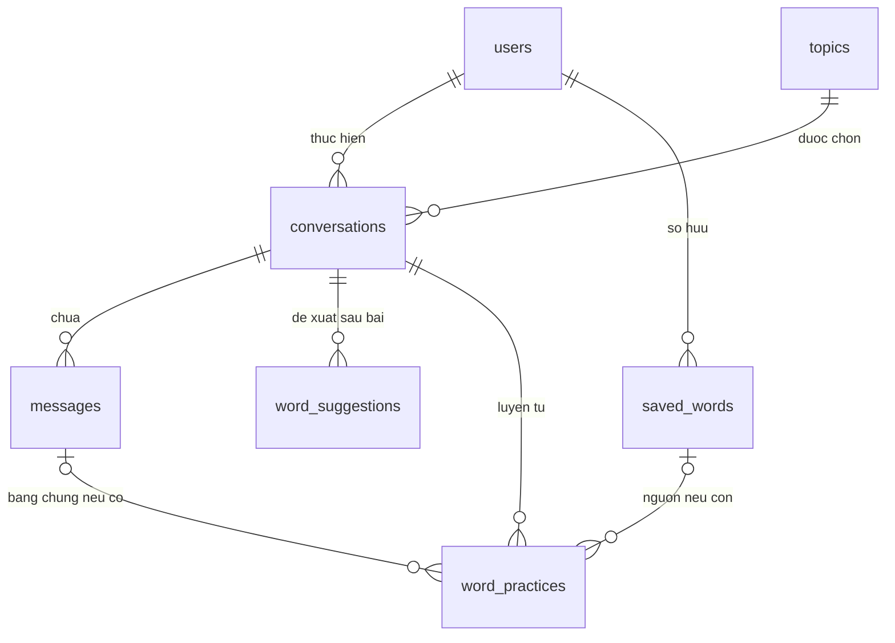

# SpeakMate — Cơ sở dữ liệu v3 và giải thích speakmate.sql

Cập nhật: **25/10/2026**, giờ Việt Nam. File dùng để triển khai mới: [speakmate.sql](../speakmate.sql). **7 bảng, 8 khóa ngoại**, MySQL 8.0.16+, InnoDB, utf8mb4.

SQL dành cho database mới/rỗng. Database đã dùng v2 nâng cấp một lần bằng [V3__account_auth.sql](migrations/V3__account_auth.sql), giữ dữ liệu và yêu cầu đăng nhập lại. SQL không DROP bảng, không tạo tài khoản hoặc mật khẩu mẫu. Backend hiện đã ánh xạ User/Topic và có luồng tài khoản; năm Entity nghiệp vụ khác được bổ sung khi triển khai từng luồng.

Đọc mục 1–3 để hiểu toàn cảnh; mục 4 là từ điển dữ liệu; mục 5–8 giải thích ràng buộc, vòng đời và 3NF. Luồng AI chi tiết ở [tài liệu hội thoại](SpeakMate-vong-doi-hoi-thoai-AI.md); cách chạy bước nền ở [README backend](../backend/README.md).

## 1. Admin vẫn có đầy đủ vai trò

Admin và người học đều là tài khoản trong **users**, phân biệt bằng **role = ADMIN hoặc USER**. Hai vai trò cố định chưa cần bảng admins, roles hoặc permissions riêng. Quyền sử dụng API do Spring Security/Service kiểm tra; cột role không tự bảo vệ endpoint.

| Admin làm gì? | Đọc/ghi bảng nào? | Quy tắc |
| --- | --- | --- |
| Đăng nhập quản trị | users | Tài khoản hoạt động và role ADMIN; không nhận role tùy ý khi đăng ký |
| Thêm chủ đề/tình huống | topics | Nhập tên, mô tả, mức gợi ý, bối cảnh/vai trò AI |
| Sửa chủ đề | topics | Chỉ tác động cấu hình cho lần mở hội thoại mới |
| Bật/tắt chủ đề | topics.is_active | Chủ đề tắt không nhận hội thoại mới, kể cả client gửi ID trực tiếp |
| Tìm, khóa/mở tài khoản | users.is_active | Kiểm tra ở backend; không tự khóa tài khoản admin đang dùng |
| Xem thống kê | Truy vấn users, topics, conversations | Đếm dữ liệu thật; chưa cần bảng statistics |
| Đọc hội thoại riêng của người học | Không thuộc phạm vi quản trị mặc định | ADMIN không tự có quyền đọc mọi transcript chỉ vì quản lý chủ đề |

Một dòng topics là **một tình huống có thể bắt đầu nói chuyện ngay**. Ví dụ “Nhận phòng khách sạn”: AI là lễ tân, người học là khách, mục đích là nhận phòng và hỏi giờ ăn sáng. Không làm thêm cây danh mục/chủ đề/bài học ở v1.

topics.level là độ khó **gợi ý**. Người học có thể chọn mức khác; conversations.level mới là mức áp dụng cho bài. Mức hồ sơ A1 không bị chặn chọn B2.

Admin tạo tình huống và vai diễn; quy tắc “không sửa lỗi giữa hội thoại” được giữ trong prompt hệ thống do backend kiểm soát. Nội dung scenario không được thay quyền hay quy tắc nghiệp vụ.

Chủ đề đã có hội thoại dùng thao tác tắt thay vì xóa. FK chặn xóa khi còn lịch sử. Tên/bối cảnh được chép vào hội thoại lúc mở nên sửa chủ đề không viết lại bài cũ. Phiên đã mở được tiếp tục theo snapshot kể cả chủ đề bị tắt.

Tài khoản admin đầu tiên được tạo bằng quy trình khởi tạo riêng có mật khẩu băm; script schema không chứa thông tin đăng nhập mặc định. Không có endpoint đăng ký công khai cho phép tự chọn ADMIN.

## 2. Bảy bảng, mỗi bảng giữ điều gì?

| Bảng | Entity dự kiến | Một dòng là gì? | Ai tạo dữ liệu? |
| --- | --- | --- | --- |
| users | User | Một tài khoản người học hoặc quản trị | Đăng ký/khởi tạo admin |
| topics | Topic | Một tình huống nói chuyện | Admin |
| conversations | Conversation | Một cuộc hội thoại và kết quả cuối bài | Người học bắt đầu, backend kết thúc/phân tích |
| messages | Message | Một câu/đoạn USER hoặc AI | Luồng gửi tin |
| word_suggestions | WordSuggestion | Một từ/cụm từ được đề xuất trong kết quả bài | Bước phân tích cuối bài |
| saved_words | SavedWord | Một mục từ cá nhân đã chọn lưu | Người học xác nhận lưu/nhập từ |
| word_practices | WordPractice | Một mục từ được chọn luyện trong một hội thoại | Chức năng luyện lại, triển khai sau vòng chính |

**6 bảng đầu phục vụ vòng chính đã yêu cầu.** Bảng thứ bảy giữ hướng luyện lại từ đã thống nhất; nói chuyện thông thường không cần tạo dòng nào trong bảng này. Có bảng không có nghĩa phải làm thêm bảy bộ API CRUD.

Không có decks. Flashcard là cách hiển thị/ôn saved_words, không cần bảng riêng chỉ vì giao diện lật thẻ.

word_suggestions và saved_words có mục đích khác nhau: bài 100 gợi ý ba từ nhưng người học chỉ lưu một từ; cả ba gợi ý vẫn cần có khi xem lại bài 100. Sửa nghĩa cá nhân không sửa kết quả bài cũ.

## 3. Quan hệ



| Khóa ngoại | Trả lời câu hỏi |
| --- | --- |
| conversations.user_id → users.id | Ai thực hiện cuộc hội thoại? |
| conversations.topic_id → topics.id | Đã chọn tình huống nào? |
| messages.conversation_id → conversations.id | Tin này thuộc cuộc hội thoại nào? |
| word_suggestions.conversation_id → conversations.id | Từ này được đề xuất trong bài nào? |
| saved_words.user_id → users.id | Ai sở hữu mục từ cá nhân? |
| word_practices.conversation_id → conversations.id | Đang luyện từ trong bài nào? |
| word_practices.saved_word_id → saved_words.id | Mục từ nguồn nào được chọn? NULL khi nguồn bị xóa |
| word_practices.evidence_message_id → messages.id | Câu thực tế nào chứa bằng chứng sử dụng? NULL khi chưa có |

Hai nơi xác định chủ sở hữu là conversations.user_id và saved_words.user_id. Tin nhắn/gợi ý/mục tiêu đi qua hội thoại; từ cá nhân thuộc trực tiếp tài khoản.

## 4. Từ điển dữ liệu

### 4.1 Trường chung

Mỗi bảng có các trường sau; các bảng phía dưới không lặp lại chúng.

| Cột SQL | Field Java | Kiểu và ràng buộc | Tác dụng |
| --- | --- | --- | --- |
| id | id | BIGINT, PK, AUTO_INCREMENT | ID bản ghi, Java Long |
| created_by | createdBy | VARCHAR(255), NOT NULL, mặc định system | Người/tác vụ tạo; Service/audit tự gán |
| created_at | createdAt | DATETIME(6), NOT NULL, mặc định thời điểm tạo | Lưu UTC, Java Instant |
| updated_by | updatedBy | VARCHAR(255), NULL | Người/tác vụ cập nhật gần nhất |
| updated_at | updatedAt | DATETIME(6), NULL | Thời điểm cập nhật, NULL trước lần cập nhật đầu |

Bốn tên audit giữ phong cách InternMatching. Đây là dấu vết tên người/tác vụ, không phải FK hay nguồn cấp quyền. SQL không có trigger tự sửa updated_at; auditing JPA chịu trách nhiệm khi triển khai.

Chuỗi tên/từ dùng collation không phân biệt hoa thường, có phân biệt dấu. Enum dùng collation phân biệt hoa thường. Service trim/chuẩn hóa và kiểm tra @NotBlank; TRIM của SQL chỉ xử lý space thông thường, chưa đủ thay validation với tab/newline/Unicode.

### 4.2 users

| Cột / Java | Kiểu | Bắt buộc / ý nghĩa |
| --- | --- | --- |
| name | VARCHAR(100) | Có, tên hiển thị |
| email | VARCHAR(255) | Có, UNIQUE, chuẩn hóa khi đăng ký/đăng nhập |
| password | VARCHAR(200), NULL | BCrypt hash; NULL khi chỉ đăng nhập Google; không trả trong DTO |
| google_subject / googleSubject | VARCHAR(255), NULL, UNIQUE | `sub` Google, so sánh phân biệt ký tự; không dùng email làm định danh Google |
| level | VARCHAR(2) | A1/A2/B1/B2/C1/C2, mặc định A1 |
| role | VARCHAR(20) | USER/ADMIN, mặc định USER |
| is_active / active | BOOLEAN | Mặc định true, CHECK chỉ 0/1 |
| refresh_token / refreshToken | TEXT, NULL | SHA-256 dạng hex 64 ký tự của refresh token hiện hành; không lưu token gốc |
| refresh_expires_at / refreshExpiresAt | DATETIME(6), NULL | Hạn refresh; có/không cùng refresh_token |
| auth_version / authVersion | BIGINT, mặc định 0, >= 0 | Số phiên; tăng khi đăng nhập mới, đăng xuất hoặc đặt lại mật khẩu để thu hồi access token cũ |
| password_reset_code_hash / passwordResetCodeHash | VARCHAR(200), NULL | BCrypt hash của mã email 6 chữ số; không trả qua API |
| password_reset_expires_at / passwordResetExpiresAt | DATETIME(6), NULL | Mặc định hết hạn sau 10 phút |
| password_reset_sent_at / passwordResetSentAt | DATETIME(6), NULL | Thời điểm cấp mã; giữ lại sau sử dụng/lỗi gửi để giới hạn yêu cầu tiếp theo |
| password_reset_attempts / passwordResetAttempts | INT, mặc định 0, CHECK 0..5 | Số lần nhập mã sai; đủ 5 lần phải xin mã mới |

V1 có một phiên và một mã khôi phục hiện hành mỗi tài khoản, nên các field phụ thuộc trực tiếp users.id; chưa cần bảng sessions/reset_tokens. Nếu muốn nhiều thiết bị hoặc lịch sử mã, khi đó mới tách bảng quan hệ 1–n. Một user phải có password hoặc google_subject, có thể có cả hai sau liên kết. Mã khôi phục chỉ dành cho tài khoản có mật khẩu; hash/hạn mã phải đi cùng và hạn sau thời điểm cấp. Đổi users.level không sửa lịch sử hoặc tự đánh giá lại các bài cũ.

Chi tiết request, transaction, giải thích từng file và cấu hình ở [Luồng tài khoản](SpeakMate-luong-tai-khoan.md). Thay đổi v3 chỉ mở rộng users; quan hệ 7 bảng/8 FK giữ nguyên.

### 4.3 topics

| Cột / Java | Kiểu | Bắt buộc / ý nghĩa |
| --- | --- | --- |
| name | VARCHAR(100) | Có, UNIQUE; tên tình huống trên màn hình chọn |
| description | TEXT, NULL | Mô tả ngắn cho người học |
| level | VARCHAR(2) | A1/A2/B1/B2/C1/C2, mức gợi ý |
| scenario | TEXT | Có; bối cảnh, vai AI và nhiệm vụ giao tiếp |
| is_active / active | BOOLEAN | Mặc định true; tắt để ngừng nhận bài mới |

Ví dụ nội dung scenario: “You are a hotel receptionist. Help the guest check in and answer questions about breakfast.” Đây là ví dụ nhập liệu, không phải seed đã được thêm vào database.

### 4.4 conversations

| Cột SQL | Field Java | Kiểu / NULL | Tác dụng |
| --- | --- | --- | --- |
| user_id | user | BIGINT, NOT NULL, FK | Người thực hiện |
| topic_id | topic | BIGINT, NOT NULL, FK | Tình huống gốc |
| create_request_id | createRequestId | CHAR(36), NOT NULL | UUID app tạo, chống tạo hai bài khi retry |
| profile_level_snapshot | profileLevelSnapshot | VARCHAR(2), NOT NULL | Mức hồ sơ lúc mở |
| level | level | VARCHAR(2), NOT NULL | Mức người học chọn |
| topic_name_snapshot | topicNameSnapshot | VARCHAR(100), NOT NULL | Tên tình huống lúc mở |
| scenario_snapshot | scenarioSnapshot | TEXT, NOT NULL | Bối cảnh dùng cho bài |
| ended_at | endedAt | DATETIME(6), NULL | NULL khi còn nói; ghi một lần khi kết thúc |
| review_status | reviewStatus | VARCHAR(20), NOT NULL | Trạng thái báo cáo, mặc định NOT_STARTED |
| summary | summary | TEXT, NULL | Nhận xét chung hoặc lý do thiếu dữ liệu |
| strengths | strengths | TEXT, NULL | Điểm làm được sau bài |
| weaknesses | weaknesses | TEXT, NULL | Điểm cần cải thiện sau bài |
| recommended_level | recommendedLevel | VARCHAR(2), NULL | Mức nên luyện tiếp theo bài này |
| level_feedback | levelFeedback | TEXT, NULL | Lý do khuyến nghị |
| self_rating | selfRating | TINYINT, NULL | Tự đánh giá 1–5 sau khi đóng, không phải điểm AI |
| processing_token | processingToken | CHAR(36), NULL | UUID của lần gọi AI đang được nhận xử lý |
| processing_started_at | processingStartedAt | DATETIME(6), NULL | Thời điểm nhận tác vụ, dùng xác định quá hạn |

Ba mức trình độ có ý nghĩa riêng: hồ sơ tại thời điểm mở, mức đã chọn và khuyến nghị cuối bài. AI không tự đổi users.level. Cả ba chỉ nhận A1/A2/B1/B2/C1/C2.

Báo cáo đầy đủ yêu cầu các phần văn bản không rỗng. Nếu không thấy điểm yếu rõ, có thể ghi trung thực “Chưa ghi nhận điểm cần sửa rõ trong phạm vi bài này”, không bịa lỗi để lấp trường. Danh sách câu sửa/từ gợi ý có thể rỗng. Chưa đủ cơ sở nhận xét thì dùng INSUFFICIENT_DATA, không ép tạo báo cáo đầy đủ.

### 4.5 messages

| Cột / Java | Kiểu | Ý nghĩa |
| --- | --- | --- |
| conversation_id / conversation | BIGINT, NOT NULL, FK | Hội thoại chứa tin |
| sender | VARCHAR(10), NOT NULL | USER hoặc AI |
| content | TEXT, NOT NULL | Câu gốc; USER tối đa 1.000, AI tối đa 4.000 ký tự |
| request_id / requestId | CHAR(36), NOT NULL | Một lượt USER và lời AI dùng chung UUID |
| corrected_content / correctedContent | TEXT, NULL | Câu USER được sửa đầy đủ, chỉ ghi sau kết thúc |
| feedback | TEXT, NULL | Giải thích bản sửa; đi cùng corrected_content |

Hai cột sửa lỗi cùng NULL hoặc cùng có nội dung và chỉ thuộc tin USER. SQL không tự biết hội thoại đã đóng khi sửa messages; Service phải kiểm tra và chỉ ghi trong transaction báo cáo. Câu gốc không bị thay bằng câu sửa.

Không dùng message_order. Vì Service chỉ nhận một lượt mới sau khi giải quyết lượt trước dưới khóa hội thoại, đọc theo id tăng dần trong cùng conversation là đủ. Auto-increment không tự bảo đảm điều này nếu bỏ quy tắc Service.

### 4.6 word_suggestions và saved_words

| Cột | word_suggestions | saved_words |
| --- | --- | --- |
| conversation_id / conversation | BIGINT, NOT NULL, FK | Không có |
| user_id / user | Không có; chủ sở hữu qua hội thoại | BIGINT, NOT NULL, FK |
| word | VARCHAR(100), NOT NULL | VARCHAR(100), NOT NULL |
| meaning | VARCHAR(255), NOT NULL | VARCHAR(255), NOT NULL |
| example | TEXT, NULL | TEXT, NULL |
| status | Không có | NEW/LEARNING/MASTERED, mặc định NEW |
| last_reviewed_at / lastReviewedAt | Không có | DATETIME(6), NULL lúc NEW |

Một từ/cụm từ là một đơn vị học. V1 có một mục cá nhân cho mỗi cách viết của một người; chưa tách nhiều nghĩa thành nhiều bản ghi cùng chữ.

Gợi ý chỉ tạo sau báo cáo thành công. Lưu từ chỉ sao chép những mục người dùng chọn. Đã có mục cùng từ thì trả mục hiện có, không tự ghi đè nghĩa. Cờ “Đã có trong Từ của tôi” tính từ saved_words hiện tại; không lưu is_saved trên gợi ý.

Sửa word/meaning cá nhân đặt lại NEW và last_reviewed_at = NULL. Ôn chuyển LEARNING/MASTERED phải có last_reviewed_at. Đây là trạng thái tự đánh giá.

### 4.7 word_practices — phần luyện lại sau vòng chính

| Cột / Java | Kiểu | Ý nghĩa |
| --- | --- | --- |
| conversation_id / conversation | BIGINT, NOT NULL, FK | Bài luyện chứa mục tiêu |
| saved_word_id / savedWord | BIGINT, NULL, FK | Từ nguồn, SET NULL khi xóa nguồn |
| word_snapshot / wordSnapshot | VARCHAR(100), NOT NULL | Cách viết lúc chọn luyện |
| meaning_snapshot / meaningSnapshot | VARCHAR(255), NOT NULL | Nghĩa lúc chọn luyện |
| result | VARCHAR(20), NOT NULL | PENDING/USED/NOT_USED/UNVERIFIED |
| evidence_message_id / evidenceMessage | BIGINT, NULL, FK | Tin làm bằng chứng nếu USED |
| feedback | TEXT, NULL | Nhận xét/lý do của kết quả |

PENDING chưa có feedback/bằng chứng. Các kết quả sau đánh giá phải có feedback; chỉ USED có evidence_message_id. USED xác nhận bằng chứng xuất hiện, chưa tự chứng minh dùng đúng nghĩa/thành thạo.

FK chỉ kiểm tra tin tồn tại. Service còn phải kiểm tra tin cùng conversation, sender USER và có bằng chứng phù hợp. Chưa đủ dữ liệu thì UNVERIFIED; báo cáo FAILED có thể giữ PENDING để retry.

## 5. Khóa và ràng buộc

Mỗi bảng có PK id. UNIQUE theo nghiệp vụ:

| Bảng | UNIQUE |
| --- | --- |
| users | email |
| topics | name |
| conversations | user_id + create_request_id |
| messages | conversation_id + request_id + sender |
| word_suggestions | conversation_id + word |
| saved_words | user_id + word |
| word_practices | conversation_id + word_snapshot; thêm conversation_id + saved_word_id |

Request UUID chỉ được SQL kiểm độ dài 36; Service kiểm định dạng, chuẩn hóa chữ thường và đối chiếu payload khi retry. Cùng mã nhưng payload khác trả xung đột, không trả nhầm kết quả cũ.

| DB bảo vệ | Backend vẫn phải bảo vệ |
| --- | --- |
| PK/FK/UNIQUE và enum/boolean/rating hợp lệ | Ai được thao tác, tài khoản/chủ đề có hoạt động không |
| Cặp token/thời điểm; cấu trúc trạng thái báo cáo trên conversations | Chuyển trạng thái hợp lệ; không mở lại bài; token cũ không ghi đè |
| Tin AI không có sửa lỗi; nội dung không rỗng bằng space | Không ghi sửa lỗi/từ gợi ý giữa cuộc trò chuyện |
| USED có FK bằng chứng tồn tại | Bằng chứng cùng bài, của USER và khớp nội dung |
| SET NULL giữ bản ghi luyện sau khi xóa từ | Snapshot bất biến, tối đa 3 từ, từ thuộc người hiện tại |
| Trùng bản ghi khi hai request cạnh tranh | Nhận diện retry, trả kết quả cũ; xử lý UNIQUE ngoài transaction đã rollback |

Không dùng trigger để giấu nghiệp vụ. CHECK của MySQL chỉ kiểm tra biểu thức trên dòng; điều kiện bắt buộc với cột nullable phải có IS NOT NULL, tránh UNKNOWN được chấp nhận. Tham khảo [MySQL CHECK](https://dev.mysql.com/doc/refman/8.0/en/create-table-check-constraints.html).

Hầu hết FK dùng RESTRICT: không xóa cha đang có lịch sử. Ngoại lệ duy nhất là saved_words → word_practices dùng SET NULL để giữ snapshot khi xóa mục cá nhân. Tham khảo [MySQL FOREIGN KEY](https://dev.mysql.com/doc/refman/8.0/en/create-table-foreign-keys.html).

## 6. Vòng đời dữ liệu

| Giai đoạn | conversations | Bảng liên quan |
| --- | --- | --- |
| Mở bài | ended_at NULL, NOT_STARTED; chép tình huống và mức hồ sơ | Không tạo gợi ý/thẻ tự động |
| Người học gửi câu | NOT_STARTED; nhận token xử lý | Lưu messages USER |
| AI đáp | Chỉ ghi nếu token còn đúng và chưa đóng; xóa token | Lưu messages AI, chưa sửa ngữ pháp |
| Kết thúc, đủ nội dung | Ghi ended_at, PROCESSING và token phân tích mới | Cố định transcript; vô hiệu lời AI còn chạy |
| Phân tích thành công | COMPLETED, đầy đủ báo cáo, xóa token | Cùng transaction ghi câu sửa/gợi ý/kết quả luyện nếu có |
| Phân tích lỗi | FAILED, giữ ended_at, xóa token; không có báo cáo dở | Giữ transcript; retry chỉ phân tích lại |
| Chưa đủ dữ liệu | INSUFFICIENT_DATA, summary là lý do, xóa token | Không tạo lỗi/từ giả; mục tiêu nếu có thành UNVERIFIED |
| Chọn lưu từ | Không đổi kết quả bài | Tạo/tìm saved_words của người học |

Nếu đang chờ lời AI rồi bấm Kết thúc, backend khóa dòng, đóng bài và thay/xóa token cũ. Kết quả cũ chỉ được ghi khi token khớp; Android cũng chặn phát TTS muộn sau thao tác kết thúc.

NOT_STARTED có thể có token lời đáp. PROCESSING bắt buộc có token phân tích. COMPLETED/FAILED/INSUFFICIENT_DATA phải xóa cả processing_token và processing_started_at. Hai cột cùng có hoặc cùng NULL.

Đọc lại không tự gọi AI. Retry dùng POST có kiểm tra hết hạn dưới khóa. RequestId giữ nguyên cho một lượt, processingToken đổi cho mỗi lần thử. Quy tắc chi tiết và vị trí hàm ở tài liệu hội thoại.

## 7. Index và thống kê cho admin

| Index bổ sung | Truy vấn phục vụ |
| --- | --- |
| topics(is_active, level) | Danh sách tình huống đang bật theo mức gợi ý |
| saved_words(user_id, status, last_reviewed_at, id) | Từ cá nhân theo trạng thái và lần ôn |
| conversations(user_id, created_at, id) | Lịch sử một người |
| conversations(topic_id, created_at) | Mức sử dụng tình huống theo thời gian |
| conversations(review_status, ended_at) | Số bài có báo cáo theo thời điểm kết thúc |
| messages(conversation_id, id) | Transcript đúng thứ tự |
| word_practices(saved_word_id), (evidence_message_id) | Liên kết từ nguồn và bằng chứng |

PK/UNIQUE cũng tạo index. Không thêm riêng user_id cho saved_words vì index hiện có đã bắt đầu bằng user_id.

Phân biệt số bài đã mở, đã đóng và có báo cáo đầy đủ. Dashboard không dùng một tên “hoàn thành” cho cả ba:

```sql
-- Bai co bao cao day du theo ngay ket thuc (tham so UTC tu backend).
SELECT COUNT(*) AS reviewed_conversations
FROM conversations
WHERE review_status = 'COMPLETED'
  AND ended_at >= :fromUtc AND ended_at < :toUtc;

-- So lan chu de duoc chon; bao gom ca bai moi mo/chua co bao cao.
SELECT t.id, t.name, COUNT(c.id) AS started_conversations
FROM topics t
LEFT JOIN conversations c ON c.topic_id = t.id
GROUP BY t.id, t.name;
```

Đây là SQL minh họa cho Repository có tham số, không phải lệnh copy nguyên vào MySQL CLI. Không cộng trực tiếp nhiều bảng con cùng lúc vì có thể nhân số dòng và đếm sai.

## 8. Kiểm tra chuẩn hóa và tối giản

Chuẩn hóa dựa trên phụ thuộc hàm, không dựa riêng vào việc “có id”. Tham khảo [Microsoft — Database normalization](https://learn.microsoft.com/en-us/previous-versions/troubleshoot/microsoft-365/microsoft-365-apps/access/database-normalization-description).

**1NF:** mỗi tin, gợi ý, từ cá nhân và lần luyện là một dòng. Không dùng word1/word2 hoặc chuỗi danh sách ID để thay quan hệ. summary/strengths/weaknesses là từng đoạn văn bản báo cáo, chưa có nghiệp vụ quản lý từng gạch đầu dòng riêng.

| Bảng | Khóa ứng viên không NULL | Phụ thuộc nghiệp vụ chính |
| --- | --- | --- |
| users | id; email | Khóa → hồ sơ/tài khoản; không lưu diễn giải role thành các cột lặp |
| topics | id; name | Khóa → cấu hình tình huống hiện tại |
| conversations | id; user_id + create_request_id | Khóa → một sự kiện học, snapshot và báo cáo |
| messages | id; conversation_id + request_id + sender | Khóa → một tin; không chép tên/email người học |
| word_suggestions | id; conversation_id + word | Khóa → nghĩa/ví dụ ở bài đó |
| saved_words | id; user_id + word | Khóa → nội dung cá nhân và trạng thái ôn |
| word_practices | id; conversation_id + word_snapshot | Khóa → một mục tiêu cùng snapshot/kết quả/bằng chứng |

**2NF/3NF:** với các phụ thuộc nghiệp vụ ở bảng trên, thuộc tính nội dung thuộc đúng đối tượng/sự kiện và phụ thuộc toàn bộ khóa. topic_id không quyết định scenario_snapshot của mọi bài qua nhiều lần sửa topic. Tương tự saved_word_id không quyết định snapshot qua mọi lần sửa từ. Snapshot lịch sử không phải dữ liệu hiện tại cần đồng bộ.

UNIQUE(conversation_id, saved_word_id) có NULL nên không là khóa ứng viên của toàn bảng. Khi có bằng chứng, evidence_message_id xác định conversation_id; conversation_id là thuộc tính khóa trong khóa ứng viên (conversation_id, word_snapshot), nên phụ thuộc đó không tự vi phạm 3NF. FK đơn vẫn cần Service kiểm tra cùng bài; chuẩn hóa không thay thế kiểm tra liên bảng.

Theo mô hình phụ thuộc nghiệp vụ đã nêu, thiết kế phù hợp 3NF ở mức dữ liệu nghiệp vụ. Không coi các CHECK enum/trạng thái, nullable hay cột audit là bằng chứng tự động đạt mọi chuẩn cao hơn; không tuyên bố BCNF hoặc mọi thay đổi tương lai đều giữ 3NF.

Không thêm bảng báo cáo 1–1 khi một hội thoại chỉ có một báo cáo hiện hành; chưa cần bảng cho từng lỗi vì một tin USER giữ một bản sửa và giải thích tổng hợp. Không thêm bảng admin/statistics hoặc bảng từ điển dùng chung nếu chưa có nghiệp vụ đòi hỏi.

## 9. File code và cách triển khai

| Nhóm file dự kiến | Trách nhiệm |
| --- | --- |
| User + Auth/User Service | Đăng nhập, vai trò, tài khoản hoạt động |
| TopicController, TopicService, TopicRepository | Người học đọc; admin thêm/sửa/bật/tắt tình huống |
| AdminTopicController / AdminUserController | Nếu có web quản trị trả view, dùng chung Service với nghiệp vụ tương ứng |
| ConversationService | Điều phối mở/gửi/kết thúc/retry |
| ConversationTransactionService | Transaction ngắn, khóa, kiểm quyền/token và lưu kết quả |
| AiClient | Hai hàm generateReply / reviewConversation; không ghi DB |
| SavedWordService | Lưu/ôn từ cá nhân; từ gợi ý phải thuộc người hiện tại |
| Entity/Repository/DTO/Mapper | Bảy ánh xạ dữ liệu, truy vấn và chuyển DTO tường minh |

Giữ phong cách InternMatching: Long id, camelCase, enum STRING, Service cụ thể, constructor injection, Mapper viết tay. Không cần CRUD Controller riêng cho messages, word_suggestions, word_practices.

SQL v3 là điểm bắt đầu cho schema mới. User đã bổ sung field phục vụ tài khoản. Dùng `ddl-auto=validate` để đối chiếu Entity đã ánh xạ với SQL; không dùng `update` để tự sửa schema. Hibernate chỉ kiểm tra phần được ánh xạ, không chứng minh năm Entity chưa viết hoặc mọi CHECK/UNIQUE đều đúng. Kết quả kiểm chứng nằm tại [README backend](../backend/README.md).

## 10. Cài mới và trạng thái kiểm chứng

Chạy SQL một lần trên database mới/rỗng bằng MySQL client hoặc công cụ DB. Script chọn tên speakmate. Nếu database hiện có dùng schema cũ hoặc có dữ liệu cần giữ, cần migration riêng; không chạy chồng và không dùng --force để bỏ qua lỗi.

Ngày 24/10/2026: đã import v3 và kiểm tra trên **MySQL Community Server 8.0.45**, tiến trình/datadir tạm riêng, cổng 13317. **77 kiểm tra SQL đạt** và **6 ca xác định giới hạn DB/Service** chạy đúng kết quả dự kiến. Migration v2 → v3 cũng đã chạy trên DB thử có tài khoản/chủ đề: giữ dữ liệu, xóa phiên cũ và cho cùng cấu trúc cột users với cài mới. Script tái hiện kiểm tra schema: [check_speakmate_schema.py](check_speakmate_schema.py), chỉ nhận server tạm chưa có database ứng dụng; từ chối cổng mặc định 3306.

Đã kiểm tra: 7 bảng/8 FK; USER/ADMIN cùng users; mức hồ sơ A1 chọn B2; enum/boolean/chuỗi/trùng/FK; đủ và thiếu trường báo cáo; token/thời điểm; đóng → lỗi → retry → hoàn tất giữ ended_at; thiếu dữ liệu; cặp USER/AI không trùng; sửa lỗi chỉ trên USER; trạng thái ôn; xóa từ cá nhân giữ snapshot/bằng chứng; sửa/tắt chủ đề giữ lịch sử.

Sáu ca giới hạn chứng minh DB đơn lẻ vẫn cho phép: sửa lỗi trước đóng; tạo gợi ý trước đóng; mở bài từ topic bị tắt; bằng chứng ở bài khác; bằng chứng là tin AI; từ nguồn khác chủ sở hữu. Các thao tác thử được rollback. Đây là điều **Service phải chặn**, không phải các ca API đã vượt qua kiểm thử.

Kết quả trên là kiểm tra SQL. Kiểm thử API tài khoản được ghi riêng tại [README backend](../backend/README.md). Chưa kiểm thử AI hoặc tích hợp Android; SQL và validate ánh xạ không chứng minh chất lượng hội thoại hoặc code chưa được viết.
