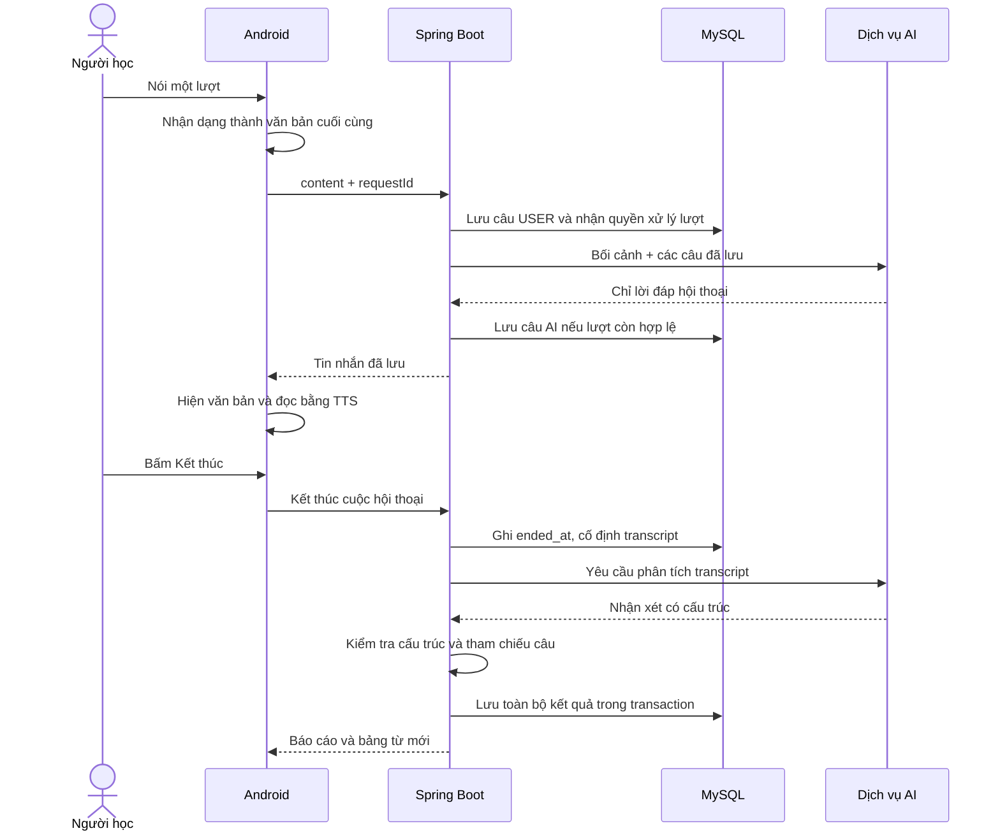

# SpeakMate — Hội thoại giọng nói và nhận xét sau khi kết thúc

**Contract triển khai của đợt 3 ngày:** [API chung FE–BE](Contract/03-hop-dong-api.md) và [OpenAPI](Contract/openapi.json). Tài liệu dưới giữ lý do nghiệp vụ/vòng đời; các URL ví dụ trước đây là đề xuất. Khi code đợt này dùng URL, JSON, timeout và ưu tiên trong bộ chung; không suy ra rằng Speaking đã được triển khai chỉ vì có tài liệu.

Ngày cập nhật: 24/10/2026, giờ Việt Nam. Yêu cầu của người phụ trách backend là căn cứ chính của tài liệu này. Đây là thiết kế hội thoại để triển khai ở các bước tiếp theo, chưa phải chức năng AI đã chạy hoặc kết quả kiểm thử thực tế. Bước nền backend/User/Topic được hướng dẫn riêng ở [README backend](../backend/README.md).

**Nguyên tắc:** trong lúc hội thoại chỉ có lời nói, văn bản và thao tác điều khiển. Sau khi người học bấm Kết thúc mới có nhận xét, khuyến nghị trình độ, lỗi ngữ pháp và từ mới. Lưu thành flashcard là lựa chọn sau đó.

Đọc mục 1–4 để hiểu sản phẩm; mục 5–8 để code backend; mục 9–10 để kiểm thử và chuẩn bị giải thích. Phần này ưu tiên hơn các mô tả cũ về góp ý trong từng lượt hoặc xem giọng AI là tính năng bổ sung.

## 1. Trải nghiệm cần hoàn thiện

1. Đăng nhập, chọn tình huống và mức luyện A1/A2/B1/B2.
2. Mở màn hình hội thoại: vai của AI, bối cảnh, nút mic, văn bản hai bên và nút Kết thúc.
3. Người học nói; app nhận dạng thành văn bản. AI trả lời đúng ngữ cảnh; app hiện văn bản và đọc câu trả lời thành tiếng.
4. Hai bên tiếp tục trao đổi. Không hiện câu sửa, điểm số, mức trình độ, danh sách lỗi hoặc từ mới giữa cuộc trò chuyện.
5. Bấm Kết thúc: dừng âm thanh/thu âm, đóng hội thoại, hiển thị trạng thái đang phân tích.
6. Có kết quả: nhận xét chung → ưu điểm → điểm cần cải thiện → lỗi ngữ pháp kèm câu gốc → gợi ý mức luyện → bảng từ/cụm từ nên học.
7. Người học có thể chọn vài từ và bấm Lưu flashcard. Không chọn gì vẫn hoàn thành bài và xem lại lịch sử bình thường.

“Xuất flashcard” ở phạm vi này được hiểu là lưu những từ đã chọn thành thẻ ôn bên trong app. Từ thuộc một danh sách “Từ của tôi”; không yêu cầu tạo bộ thẻ.

Luyện lại từ đã lưu vẫn là hướng mở rộng đã có trong kế hoạch, nhưng triển khai sau khi vòng hội thoại–kết quả–lưu từ chạy ổn. Một phiên nói chuyện bình thường không bắt người học chọn mục tiêu từ vựng trước.

## 2. Nói chuyện bằng giọng nói theo cách vừa sức

### 2.1 Phân công Android và backend

Chọn v1 **nói theo lượt**: người học chạm mic, nói một câu/đoạn ngắn; mặc định khi có kết quả nhận dạng cuối cùng thì tự gửi, sau đó AI tự phát lời đáp. Nếu nhận dạng trên thiết bị thường sai, người học có thể bật chế độ “Xác nhận trước khi gửi” trước lượt nói: kết quả thành bản nháp để sửa/nói lại rồi bấm gửi. Tin đã gửi không bị sửa ngược trong lịch sử. Không gửi các kết quả nhận dạng tạm thành nhiều tin nhắn. Nút dừng phát lời AI giúp người học chủ động chuyển lượt. Đây không phải chế độ hai bên nói chồng nhau như cuộc gọi realtime.

Android có SpeechRecognizer để nhận dạng và TextToSpeech để phát văn bản. SpeechRecognizer không được thiết kế cho nhận dạng liên tục vô hạn; cần quyền mic và xử lý vòng đời đúng. Nguồn: [Android SpeechRecognizer](https://developer.android.com/reference/android/speech/SpeechRecognizer).

TTS phải khởi tạo thành công, có giọng/ngôn ngữ phù hợp; callback kết thúc/lỗi giúp ứng dụng biết lúc nào lời phát đã dừng. Nguồn: [Android TextToSpeech](https://developer.android.com/reference/android/speech/tts/TextToSpeech), [UtteranceProgressListener](https://developer.android.com/reference/android/speech/tts/UtteranceProgressListener).

Quyết định cho v1: dùng nhận dạng và TTS của Android để giữ backend tập trung vào nội dung hội thoại. Chất lượng giọng phụ thuộc engine/thiết bị, phải nghe thử trên điện thoại demo. Nếu giọng không đạt yêu cầu, có thể thay phần phát bằng TTS dịch vụ sau khi thử thực tế; không giả định giọng mặc định chắc chắn tự nhiên. Chưa cần WebSocket, WebRTC, lưu audio hoặc truyền âm thanh liên tục qua backend.

### 2.2 Quy tắc để trải nghiệm không bị vỡ

- Không mở mic khi TTS đang phát; tránh thu lại chính câu AI. Người học có thể dừng phát rồi bắt đầu lượt mới.
- Chỉ tự đọc tin AI vừa nhận trong lượt hiện tại. Mở lại lịch sử hoặc lấy lại response cũ không tự đọc toàn bộ hội thoại lần nữa.
- Khi người học đã bấm Kết thúc, giao diện chuyển sang đang đóng và không phát TTS từ response gửi tin đến muộn. Lời AI có thể đã được server lưu ngay trước khi đóng nhưng HTTP về chậm; tải lại transcript để hiển thị đúng lịch sử, không tự mở lại cuộc trò chuyện.
- TTS lỗi: văn bản đã lưu vẫn còn, cho bấm nghe lại. Không gọi AI sinh lại câu chỉ vì phát âm thanh thất bại.
- Không nghe thấy lời nói hoặc nhận dạng lỗi: không tạo messages rỗng; cho nói lại hoặc nhập văn bản.
- Bản nháp chưa gửi thuộc giao diện. Khi bấm Kết thúc mà còn bản nháp, cho lựa chọn rõ gửi câu đó trước hoặc bỏ bản nháp; không âm thầm coi nó đã được server ghi nhận.
- App xuống nền, bị cuộc gọi chen vào hoặc người học rời màn hình: dừng mic/TTS. Khi quay lại, tải trạng thái server; không tự mở mic.
- Từ chối quyền mic hoặc thiết bị thiếu dịch vụ nhận dạng/TTS phải có thông báo và lựa chọn nhập/đọc văn bản, không hiển thị giả trạng thái đang nghe/nói.

## 3. Hai nhiệm vụ AI tách biệt

| Nhiệm vụ | Khi gọi | Đầu vào chính | Đầu ra |
| --- | --- | --- | --- |
| generateReply | Mỗi lượt đã được backend nhận | Tình huống, vai, mức đã chọn, transcript | Một lời đáp hội thoại |
| reviewConversation | Sau khi đóng hội thoại | Transcript có ID, mức đã chọn, mức hồ sơ lúc bắt đầu | Báo cáo, câu sửa và từ gợi ý |

Hai nhiệm vụ có thể dùng cùng một nhà cung cấp/model. Không cần hai hệ thống AI riêng.

### 3.1 Nhiệm vụ trò chuyện

Prompt phải thể hiện: đóng đúng vai; phản hồi điều người học vừa nói; không hỏi lại điều đã được trả lời; thông thường trả lời ngắn 1–3 câu và hỏi tiếp một câu phù hợp; không biến mọi lượt thành một cuộc phỏng vấn. Giữ chủ đề và mức luyện đã chọn, nhưng có thể diễn đạt lại khi người học yêu cầu làm rõ.

Trong chế độ này không chấm điểm, không giải thích lỗi ngữ pháp, không công bố trình độ, không đưa bảng từ mới. Không chỉ giấu nhận xét khỏi UI: lời nói AI cũng không được chen nhận xét vào cuộc trò chuyện. Endpoint gửi tin trả DTO lời đáp, không trả DTO báo cáo.

Ví dụ:

- Người học: “Yesterday I go to a hotel.”
- AI tiếp tục trao đổi: “Was it for a holiday or a work trip?”
- Câu sửa “Yesterday I went to a hotel.” chỉ xuất hiện sau khi kết thúc.

V1 cho người học chủ động mở lượt đầu tiên sau khi đọc bối cảnh. Nếu sau này thêm lời chào AI tự động, phải xử lý gửi lại khi tạo phiên và không tính lời chào thành một lượt người học đã hoàn thành.

### 3.2 Nhiệm vụ phân tích sau hội thoại

Báo cáo cần có các phần dưới đây. Nhận xét bằng tiếng Việt; câu hội thoại, câu sửa và ví dụ giữ tiếng Anh.

| Phần | Nội dung cần có |
| --- | --- |
| summary | Người học đã diễn đạt và duy trì nội dung cuộc trao đổi như thế nào |
| strengths | Điểm làm được, gắn với nội dung thực tế |
| weaknesses | Một vài điểm cần tập trung cải thiện, tránh liệt kê chung chung |
| grammarCorrections | ID tin USER, câu sửa đầy đủ và giải thích; backend lấy câu gốc từ DB |
| recommendedLevel + levelFeedback | Mức nên luyện tiếp và lý do, phân biệt với mức hồ sơ/mức vừa chọn |
| suggestedWords | Từ/cụm từ hữu ích, nghĩa tiếng Việt và câu ví dụ theo bối cảnh |

Nếu không phát hiện lỗi, danh sách sửa lỗi có thể rỗng. Không yêu cầu AI phải bịa đủ số lỗi hoặc đủ từ mới. Bảng từ mới là các mục nên học, không phải khẳng định tất cả đều hoàn toàn chưa biết đối với người học.

Một tin USER có nhiều lỗi vẫn dùng một bản correctedContent hoàn chỉnh và một phần giải thích tổng hợp. V1 chưa cần bảng riêng cho từng dấu phẩy hoặc từng loại lỗi trong một câu.

## 4. Hồ sơ A1, chọn B2 thì xử lý ra sao?

Phân biệt ba dữ kiện:

| Dữ kiện | Ý nghĩa | Ai quyết định? |
| --- | --- | --- |
| profileLevelSnapshot | Mức hồ sơ khi bắt đầu, ví dụ A1 | Chép từ hồ sơ ở backend |
| level | Mức muốn luyện trong cuộc hội thoại, ví dụ B2 | Người học chọn một giá trị hợp lệ |
| recommendedLevel | Mức nên luyện tiếp theo nhận xét của bài này | Backend lưu đầu ra AI đã kiểm tra; người học cân nhắc |

Cho người học chọn B2 dù hồ sơ là A1. Trong cuộc trò chuyện không bật nhận xét “bạn yếu” hoặc tự chuyển cấu hình về A1. Trình độ hồ sơ không phải bằng chứng người học chắc chắn làm bài kém; prompt trả lời dùng mức đã chọn, còn mức hồ sơ là thông tin bổ sung cho bước đánh giá sau đó.

Ví dụ phản hồi cuối bài, khi các câu thực tế cho thấy cần củng cố nền tảng:

> Bạn đã diễn đạt được nhu cầu đặt phòng bằng những câu ngắn. Một số câu kể chuyện quá khứ còn dùng động từ hiện tại. Với mức hồ sơ A1 và những nội dung vừa thể hiện, bạn nên luyện thêm tình huống A1 trước khi quay lại bài B2. Hãy tập trung nói rõ yêu cầu và dùng thì quá khứ trong các ví dụ vừa sửa.

Đây là ví dụ cách viết nhận xét, không phải kết quả đánh giá một người thật. Nếu bài thể hiện tốt thì không ép khuyến nghị A1 chỉ vì hồ sơ đang là A1. Không tự cập nhật users.level sau một cuộc hội thoại.

CEFR có mô tả theo nhiều hoạt động/kỹ năng; A1 và B2 không chỉ khác nhau ở số lỗi ngữ pháp. Tham khảo [thang mô tả tổng quát của Council of Europe](https://www.coe.int/en/web/common-european-framework-reference-languages/table-1-cefr-3.3-common-reference-levels-global-scale). SpeakMate đưa khuyến nghị mức luyện từ nội dung bài, không cấp kết quả kiểm định CEFR.

### Khi chưa đủ dữ liệu

Đề xuất ngưỡng kỹ thuật khởi đầu: ít nhất 3 tin USER có nội dung và khoảng 30 từ cộng lại mới gửi yêu cầu phân tích đầy đủ. Đây là tham số sản phẩm để thử nghiệm, không phải tiêu chuẩn CEFR. Đủ số lượng vẫn chưa chắc đủ ý nghĩa; đầu ra AI có thể báo dữ liệu không đủ hoặc không phù hợp để nhận xét.

Nếu chỉ có “Hi”, “Yes”, hoặc hội thoại quá ngắn: vẫn đóng và lưu lịch sử; hiển thị “Chưa đủ nội dung để nhận xét, hãy thử một cuộc hội thoại dài hơn”. Không sinh điểm yếu giả, không suy ra A1 và không tạo flashcard giả cho đầy màn hình.

Backend hiện chỉ nhận transcript, nên nhận xét tập trung vào nội dung, ngữ pháp, từ vựng và cách diễn đạt bằng văn bản. Không kết luận chất lượng phát âm, ngữ điệu hoặc tốc độ nói từ transcript. Văn bản nhận dạng sai có thể làm nhận xét sai; người học cần được xem câu đã ghi nhận và nhận biết giới hạn này.

## 5. Dữ liệu cần sửa trong phương án 7 bảng

Giữ mô hình 7 bảng, không thêm bảng chỉ vì màn hình kết quả có nhiều mục. Các trường dưới đây đã được đưa vào [speakmate.sql v3](../speakmate.sql) và [từ điển dữ liệu hiện tại](SpeakMate-thiet-ke-co-so-du-lieu.md). Bước nền mới ánh xạ User/Topic trong `backend/`; Entity hội thoại/từ vựng, API và vòng đời ở đây vẫn là thiết kế để triển khai tiếp.

| Bảng / trường | Quyết định |
| --- | --- |
| conversations.create_request_id | UUID do app tạo để gửi lại yêu cầu bắt đầu mà không tạo hai hội thoại; UNIQUE(user_id, create_request_id) |
| conversations.profile_level_snapshot | Giữ mức hồ sơ tại lúc mở phiên |
| conversations.level | Giữ mức người học thực sự chọn; không thay đổi trong phiên |
| conversations.ended_at | Thời điểm đóng, ghi đúng một lần trước khi gọi phân tích |
| conversations.review_status | NOT_STARTED, PROCESSING, COMPLETED, FAILED hoặc INSUFFICIENT_DATA |
| conversations.summary, strengths, weaknesses | Ba đoạn TEXT riêng, chỉ được ghi ở bước kết thúc; chưa cần danh sách con/bảng riêng |
| conversations.recommended_level, level_feedback | Khuyến nghị và lý do của bài; chưa đủ dữ liệu thì recommended_level NULL |
| conversations.processing_token, processing_started_at | Dấu nhận diện một lần gọi AI; cặp này cùng có hoặc cùng NULL |
| messages.content | Câu gốc bất biến sau khi gửi; không thay bằng câu đã sửa |
| messages.corrected_content, feedback | NULL trong lúc trò chuyện; chỉ ghi cho tin USER khi phân tích thành công |
| word_suggestions | Chỉ tạo sau phân tích thành công; thuộc cuộc hội thoại |
| saved_words | Chỉ tạo khi người học chọn lưu; mặc định NEW, không tự tạo từ mọi gợi ý |
| word_practices | Phần luyện lại từ ở bước sau; nếu có mục tiêu thì chỉ ghi nhận xét/bằng chứng sau khi kết thúc |

Các trường ID, snapshot bối cảnh, audit, quyền sở hữu và ràng buộc không trùng vẫn giữ theo bản rà soát. Mức hồ sơ, mức đã chọn và mức được khuyên là ba sự kiện khác nhau, không phải ba bản sao cần đồng bộ.

### Trạng thái báo cáo

| Trạng thái | ended_at | Ý nghĩa / hành động |
| --- | --- | --- |
| NOT_STARTED | NULL | Đang hội thoại, chưa có nhận xét; có thể đang chờ lời AI |
| PROCESSING | Có | Hội thoại đã đóng, phân tích đang chạy |
| COMPLETED | Có | Báo cáo và từ gợi ý đã lưu xong |
| FAILED | Có | Hội thoại vẫn được giữ, cho thử phân tích lại |
| INSUFFICIENT_DATA | Có | Đã đóng nhưng chưa đủ nội dung; giải thích ngắn, không đưa kết luận trình độ |

review_status nói về báo cáo, không thay cho ended_at. Khi PROCESSING, dấu xử lý AI phải có. Khi COMPLETED/FAILED/INSUFFICIENT_DATA, dấu xử lý phải được xóa. NOT_STARTED có thể có dấu xử lý do đang sinh lời đáp. Không cho ghi nhận xét hoặc từ gợi ý khi ended_at còn NULL.

COMPLETED cần summary và các phần bắt buộc hợp lệ; không buộc có lỗi ngữ pháp/từ mới nếu không có mục phù hợp. FAILED không chứa báo cáo lưu dở. INSUFFICIENT_DATA giữ lý do ngắn trong summary, các kết luận và danh sách phân tích để trống. Số phiên “có báo cáo đầy đủ” phải đếm review_status = COMPLETED, không chỉ kiểm tra summary khác NULL.

## 6. API và vòng đời lỗi cụ thể

Tên endpoint là phương án contract để triển khai, chưa có code chạy.

| API | Mục đích / hành vi khi gọi lại |
| --- | --- |
| POST /conversations | Tạo theo topicId, level, createRequestId; cùng mã/cùng nội dung trả cùng hội thoại, khác nội dung báo 409 |
| POST /conversations/{id}/messages | Gửi content + requestId; nếu lượt đã có lời AI thì trả cặp tin cũ, không gọi AI lại |
| GET /conversations/{id} | Đọc trạng thái và transcript đã lưu để khôi phục màn hình |
| POST /conversations/{id}/finish | Đóng một lần, bắt đầu phân tích nếu đủ nội dung; gọi lại không đổi ended_at |
| GET /conversations/{id}/review | Đọc trạng thái/kết quả hiện có, không tự gọi AI hoặc sửa DB |
| POST /conversations/{id}/review/retry | Nhận lại tác vụ lỗi hoặc quá hạn; không tạo hội thoại mới |
| POST /saved-words/from-suggestions | Lưu danh sách suggestionIds được chọn; kiểm tra chúng thuộc người hiện tại, trả cả mục mới và mục đã có |

Các endpoint đều xác thực, kiểm tra tài khoản hoạt động và quyền sở hữu. ID trong body không phải căn cứ để cấp quyền. Lưu một nhóm từ dùng một transaction: có ID không hợp lệ/sai chủ sở hữu thì từ chối cả nhóm; trùng từ cá nhân là kết quả đã có, không ghi đè nội dung.

### 6.1 Gửi một lượt

1. Khóa ngắn dòng hội thoại. Kiểm tra tài khoản, chủ sở hữu, nội dung hợp lệ và requestId.
2. Tra requestId trước khi quyết định có xử lý mới: cùng mã nhưng nội dung khác thì 409; đã có USER+AI thì trả cặp tin đã lưu, kể cả hội thoại vừa đóng. Đây chỉ là lấy lại kết quả, không ghi thêm hoặc phát lại âm thanh.
3. Chưa có cặp tin hoàn chỉnh thì kiểm tra ended_at: đã đóng trả 409, không nhận hoặc chạy lại lượt. Còn mở mà token xử lý chưa hết hạn thì trả 202. Nếu USER cũ chưa có AI và không còn token hợp lệ, chỉ cho nhận lại chính requestId ấy; token quá hạn được thay dưới khóa. Không nhận lượt mới khi lượt cũ chưa được giải quyết.
4. Lưu USER nếu chưa tồn tại, sinh processingToken mới, ghi thời điểm nhận việc; commit.
5. Gọi generateReply ngoài transaction. Trả về phải là lời đáp hợp lệ, không phải báo cáo.
6. Mở transaction ngắn, khóa lại hội thoại, kiểm tra token còn đúng và ended_at vẫn NULL rồi mới lưu AI và xóa dấu xử lý.
7. Nếu lỗi, chỉ xóa dấu xử lý của chính token đang giữ; giữ USER để retry. Không xóa tác vụ mới hoặc mở lại phiên đã đóng.

requestId là mã một lượt, giữ nguyên khi retry. processingToken là mã một lần thử gọi AI, đổi khi retry. Không cam kết nhà cung cấp chỉ tính phí một lần trong mọi lỗi mạng; cam kết cần kiểm chứng là dữ liệu không bị nhân đôi và kết quả cũ không ghi đè kết quả mới.

Phục hồi lời đáp bị treo dùng chính POST gửi tin với requestId/content cũ: giữ USER, nhận token mới rồi gọi AI. GET chỉ đọc trạng thái và cho biết có thể thử lại; không tự nhận tác vụ. Khi đã đóng, USER cuối chưa có AI được giữ như lượt dừng khi kết thúc, không tạo lời đáp bổ sung.

### 6.2 Kết thúc, kể cả khi AI đang trả lời

1. Android dừng mic/TTS và xử lý bản nháp chưa gửi. Backend khóa dòng hội thoại.
2. Nếu chưa đóng, ghi ended_at. Lượt AI đang chạy bị vô hiệu hóa bằng cách thay/xóa token cũ; không phải chờ nhà cung cấp trả xong mới cho đóng.
3. Transcript dùng để phân tích là các tin đã được DB nhận trước khi đóng. Nếu còn một USER cuối chưa có câu AI, giữ câu USER đó; giao diện thể hiện lượt đã dừng do kết thúc.
4. Nếu request đến sau lúc đóng cần tạo hoặc chạy lại một lượt chưa hoàn chỉnh, trả 409; nếu chỉ lấy lại cặp USER+AI đã lưu cùng requestId/content thì trả dữ liệu cũ. Client đối chiếu requestId với transcript tải lại để biết câu nào đã được ghi nhận; không tự đánh dấu bản nháp là đã gửi thành công.
5. Chưa đủ nội dung: lưu INSUFFICIENT_DATA và lý do; không gọi phân tích đầy đủ. Nếu có mục tiêu word_practices, đặt UNVERIFIED, bằng chứng NULL và lý do chưa đủ nội dung trong cùng transaction.
6. Đủ nội dung: lưu PROCESSING và một token mới, commit rồi gọi reviewConversation.
7. Khi có kết quả, kiểm tra cấu trúc và tham chiếu; transaction cuối chỉ ghi nếu token còn đúng. Cùng transaction lưu các trường báo cáo, câu sửa trên messages, word_suggestions và kết quả word_practices nếu có, rồi đổi COMPLETED/xóa dấu xử lý.
8. AI trả chưa đủ cơ sở dù đạt ngưỡng số từ: ghi INSUFFICIENT_DATA theo quy tắc trên. AI/network/JSON lỗi: rollback phần kết quả, ghi FAILED qua giao dịch phục hồi nếu token vẫn đúng. Transcript và ended_at luôn được giữ. Mục tiêu trong bài FAILED còn PENDING để thử phân tích lại; UI ghi “Chưa đánh giá”, không hiển thị như bằng chứng chưa dùng từ.

Request finish lặp khi PROCESSING trả 202 để app đọc trạng thái; khi COMPLETED hoặc INSUFFICIENT_DATA thì trả kết quả hiện có. Khi FAILED, hiển thị nút Thử phân tích lại; không tự gọi AI vô hạn do người dùng refresh màn hình.

Nếu server chết giữa chừng, review/retry kiểm tra hạn xử lý dưới khóa, thay token và chạy lại. GET chỉ phản ánh trạng thái/quyền retry, không âm thầm nhận tác vụ. Kết quả cũ đến muộn bị bỏ vì token không khớp. Không cập nhật lại ended_at khi retry.

### 6.3 Các lỗi người dùng thực sự gặp

| Tình huống | App cần làm | Backend/dữ liệu |
| --- | --- | --- |
| Mất mạng trước khi gửi | Giữ bản nháp, cho gửi lại | Chưa coi là có messages |
| Mất response sau khi đã lưu | Tải lại hoặc retry cùng requestId | Trả dữ liệu đã có, không tạo trùng |
| Hai lượt gửi đồng thời | Hiện đang xử lý một lượt | Khóa/token bảo đảm chỉ một tác vụ được nhận |
| AI không trả lời hoặc lỗi nhà cung cấp | Có nút thử lại/kết thúc, không quay chờ vô hạn | USER và lịch sử vẫn còn |
| AI trả JSON báo cáo sai hoặc dẫn sai tin | Báo chưa tạo được kết quả, cho thử lại | Không lưu báo cáo dở hoặc nhận xét sang phiên khác |
| Kết thúc trong lúc AI đang trả lời | Dừng phát/thu, chuyển sang phân tích | Đóng phiên, vô hiệu token lời đáp cũ |
| App đóng trong lúc phân tích | Mở lại lịch sử để xem trạng thái | Tác vụ có thể đã xong; không tự tạo lại phiên |
| Tổng kết lỗi sau khi đã đóng | Cho thử phân tích lại | Giữ transcript và thời điểm kết thúc |
| TTS lỗi nhưng đã có câu AI | Hiện text, cho nghe lại | Không tạo lại lời AI |
| Token đăng nhập hết hạn | Refresh một lần rồi gửi lại đúng mã; thất bại thì đăng nhập lại | Không dùng requestId mới cho thao tác đang phục hồi |
| ID thuộc người khác/tài khoản bị khóa | Trả thông báo quyền phù hợp | Không trả nội dung hội thoại/từ cá nhân |
| Chọn lưu cùng từ nhiều lần | Hiện đã có trong Từ của tôi | UNIQUE(user_id, word), không tạo bản sao hoặc ghi đè nghĩa |

## 7. Chỗ nào nằm trong file code nào?

Các tên dưới đây là file/hàm dự kiến; người phụ trách tự viết từng luồng.

| File/hàm | Trách nhiệm |
| --- | --- |
| ConversationController | Nhận request bắt đầu/gửi/kết thúc/đọc kết quả; không gọi Repository hoặc AI trực tiếp |
| ConversationService.startConversation | Điều phối tạo cuộc hội thoại có requestId chống trùng |
| ConversationService.sendMessage | Điều phối nhận lượt → generateReply → ghi kết quả; không bọc cả cuộc gọi AI trong transaction |
| ConversationService.finishConversation / retryReview | Điều phối đóng phiên → kiểm tra đủ nội dung → reviewConversation → lưu kết quả |
| ConversationTransactionService | Các phương thức @Transactional ngắn: tạo, nhận lượt, ghi lời đáp, đóng phiên, lưu/phục hồi báo cáo; kiểm tra ownership và token ngay trong thao tác ghi |
| ConversationRepository, MessageRepository | Truy vấn theo chủ sở hữu/requestId, khóa dòng hội thoại, lấy transcript |
| ConversationPromptBuilder | Hai hàm tạo ngữ cảnh trò chuyện và ngữ cảnh đánh giá; tình huống/level đi từ dữ liệu server |
| AiClient.generateReply / reviewConversation | HTTP tới nhà cung cấp, timeout, chuyển response về kiểu rõ ràng; không tự ghi DB |
| ConversationReviewValidator | Kiểm tra báo cáo, giới hạn danh sách, enum và messageId thuộc đúng hội thoại/USER |
| DTO request/response và ConversationMapper | Tách response lời đáp với response nhận xét; không cho client tự gửi các trường kết quả/audit |
| SavedWordService | Lưu những từ người học chọn, kiểm tra nguồn gợi ý và trùng từ |
| Android SpeechController | Nhận dạng tiếng nói theo lượt và lỗi/quyền mic; đây là code phía mobile |
| Android SpeechPlaybackController | Đọc lời AI, dừng/nghe lại, xử lý callback; đây là code phía mobile |

ConversationTransactionService là một class phụ có mục đích cụ thể: giữ transaction ngắn và đi qua Spring proxy khi gọi từ ConversationService. Tránh đặt @Transactional ở một hàm rồi gọi bằng this trong cùng class và tưởng rằng transaction đã được mở. Tham khảo [Spring — transaction annotations](https://docs.spring.io/spring-framework/reference/data-access/transaction/declarative/annotations.html).

Không cần ServiceImpl cho từng bảng hoặc một base CRUD tổng quát. Nếu gặp UNIQUE do request đồng thời, để giao dịch ghi rollback rồi đọc lại bản ghi đã có trong giao dịch mới; không cố truy vấn tiếp trong giao dịch đã bị đánh dấu rollback.

## 8. Kiểm soát đầu ra và giới hạn vừa đủ

- Người dùng nói gì được coi là dữ liệu hội thoại. Nội dung đó không được đổi quyền, trạng thái tài khoản, level hồ sơ hoặc các quy tắc đánh giá ở backend.
- JSON AI chỉ là đầu vào cần kiểm tra. messageId trong sửa lỗi/bằng chứng phải tồn tại, thuộc cùng conversation và sender USER; câu gốc lấy từ DB. Một message chỉ có tối đa một bản sửa đầy đủ trong response.
- Các đoạn nhận xét lưu dưới dạng văn bản, không render HTML do AI cung cấp. Kiểm tra độ dài và xử lý nội dung ở lớp hiển thị phù hợp.
- Không yêu cầu mỗi câu phải có lỗi. Không chấm phát âm/tốc độ nói khi không phân tích audio. Góp ý nội dung vẫn cần bộ ví dụ kiểm tra thủ công; đúng ID không tự chứng minh nhận xét AI đúng.
- Mẫu ngưỡng để bắt đầu thử: 20 lượt USER/phiên, 1.000 ký tự mỗi lượt; khi đến giới hạn vẫn cho kết thúc/xem kết quả. Gửi toàn bộ transcript trong giới hạn này, không cắt mất phần đầu mà không nói rõ.
- Timeout khởi đầu: lời đáp 20 giây, phân tích 45 giây, dấu xử lý quá hạn 90 giây; mỗi lần thử chỉ gọi nhà cung cấp một lần. Đây là cấu hình thử nghiệm, phải đo với model và mạng thực tế; không phải lời hứa về độ trễ hay tiêu chuẩn ngành. Nếu đổi retry/timeout thì phải điều chỉnh hạn xử lý tương ứng.
- Cấu hình giới hạn output và kiểm tra tổng ngữ cảnh phù hợp model được chọn. Chưa chọn provider/model hoặc mua dịch vụ trong bước thiết kế này.
- Khóa API chỉ ở backend. Log requestId/conversationId/mã lỗi để tìm luồng, không cần log toàn bộ transcript hoặc token đăng nhập.

## 9. Tiêu chí nghiệm thu và ví dụ giảng viên có thể hỏi

| Ca phải chạy | Kết quả mong đợi / câu giải thích |
| --- | --- |
| Nói 5–10 lượt theo một tình huống | AI nhớ thông tin đã nói, trả lời liên quan, không tự chuyển vai; transcript đủ USER/AI |
| Cố ý nói sai ngữ pháp giữa phiên | AI tiếp tục trò chuyện; không bật hay đọc câu sửa trong lúc đang nói |
| Kết thúc sau phiên có nội dung | Hiện đủ các phần báo cáo; bấm lỗi dẫn về đúng câu USER |
| A1 chọn B2 và bài còn khó | Có khuyến nghị mức luyện kèm lý do/câu thực tế, không tự hạ users.level |
| A1 chọn B2 nhưng bài thể hiện tốt | Không áp dụng cứng “hồ sơ A1 thì luôn khuyên A1” |
| Kết thúc sau Hi/Yes | INSUFFICIENT_DATA, giữ lịch sử, không bịa nhận xét/trình độ |
| Phát âm nghe tự nhiên/độ trễ | Nghe thử giọng trên máy thật; đo từ lúc chốt câu nói đến lúc bắt đầu phát AI; không chỉ test JSON |
| App mất response rồi gửi lại | Cùng createRequestId/requestId trả cùng đối tượng/kết quả |
| Bấm Kết thúc khi lời AI chưa về | Không có tin AI muộn chen vào sau khi đã đóng, không đổi ended_at |
| AI tổng kết sai JSON/ID/timeout | FAILED, không có kết quả lưu dở; retry phục hồi đúng |
| Token xử lý cũ trả về sau retry | Không ghi đè tác vụ mới, không xóa token mới |
| Server dừng khi đang sinh lời đáp | Retry cùng requestId sau hết hạn nhận token mới; không tạo lại USER hoặc treo 202 mãi |
| HTTP lời đáp về sau khi đã bấm Kết thúc | Android không phát giọng AI hoặc mở lại màn hình chat từ response muộn |
| Bỏ chọn flashcard hoặc chọn một phần | Hoàn thành hội thoại bình thường; chỉ các mục được chọn xuất hiện trong Từ của tôi |
| Đổi ID sang dữ liệu người khác | Bị chặn ở backend, không phụ thuộc việc UI có ẩn nút hay không |

Những ca này là yêu cầu kiểm thử tiếp theo, chưa được chạy vì chưa triển khai backend/mobile mới. “Hội thoại tự nhiên” cần kiểm tra cả nội dung, giọng và nhịp chờ; sơ đồ và prompt riêng lẻ chưa chứng minh điều đó.

## 10. Thứ tự để người phụ trách tự code và giải thích

1. Tạo một hội thoại, gửi text, nhận text từ AI thật và giữ ngữ cảnh. Chỉ cần đúng tình huống, đúng vai và không sửa lỗi giữa phiên.
2. Làm requestId, ownership, giới hạn, timeout và retry ngay trên luồng text này.
3. Tích hợp Android nhận dạng/phát giọng nói trên cùng API; xử lý mic/TTS và nhịp từng lượt.
4. Làm Kết thúc, nhận xét có cấu trúc, kiểm tra messageId và xử lý lỗi báo cáo; bảo đảm đóng phiên không phụ thuộc AI thành công.
5. Làm khuyến nghị mức luyện, đủ/thiếu dữ liệu, màn hình từ mới và tùy chọn lưu thẻ.
6. Khi vòng chính đạt các ca ở mục 9 mới bổ sung luyện lại từ có mục tiêu và mở rộng khác.

Mỗi use case phải chỉ được: Controller nào nhận → Service nào điều phối → transaction nào ghi gì → AI nhận gì → lỗi thì dữ liệu còn gì. Đây là bản đồ để tự hiểu và bảo vệ dự án; không thay việc tự chạy, sửa một quy tắc và kiểm tra hậu quả của thay đổi.
